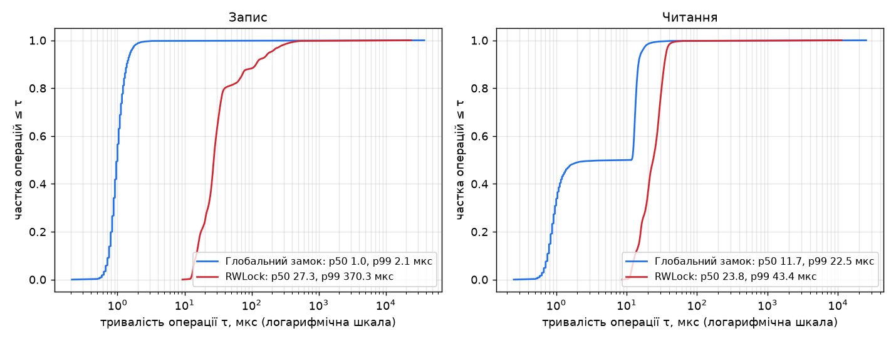
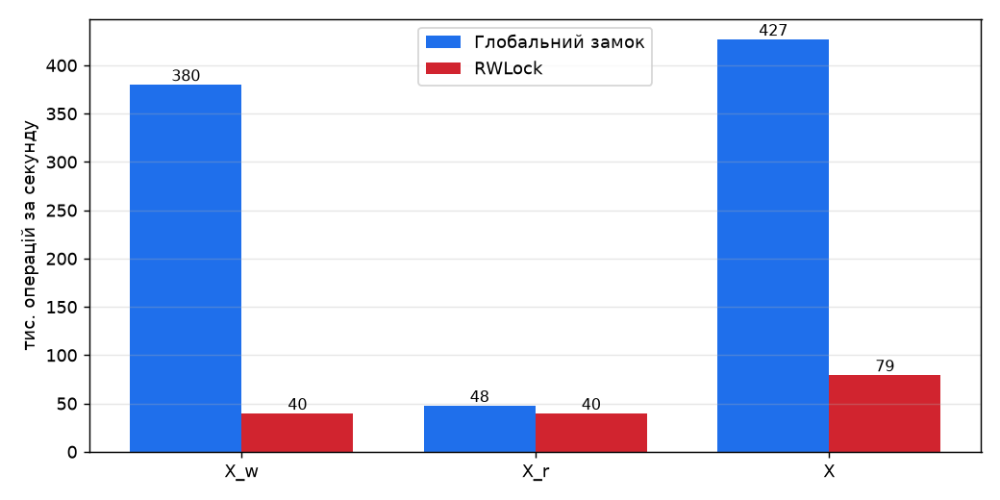

# Лабораторна робота №5. Проєктування потокобезпечної структури даних

Варіант 18.
* Структура: С8, двійкове дерево пошуку записів, ключі від 0 до 99 999 (Variant_parametr_3 = 100 000).
* Операції запису: `insert(k)` і `remove(k)` порівну, видалення лише позначає вузол видаленим.
* Операції читання: `contains(k)` і `range_count(lo, hi)` порівну.
* Потоків n = 3: n_w = ⌈3 / 2⌉ = 2 (потоки 1 і 3), n_r = ⌊3 / 2⌋ = 1 (потік 2).
* Перед кожним прогоном дерево заповнюється половиною простору ключів (50 000 ключів).

## Структура проєкту
* `lab5/bst.py` - дерево без синхронізації, перевірка інваріантів і відбиток усіх полів для перевірки читань.
* `lab5/locks.py` - глобальний замок (`threading.Lock`) і RWLock на `threading.Condition`.
* `lab5/structure.py` - потокобезпечна обгортка: запис бере замок у режимі запису, читання - у режимі читання; фіксує момент отримання замка і момент перед звільненням.
* `lab5/bench.py` - стенд: прогони на n потоках, режим X_1, перевірка читань, серія.
* `lab5/analyze.py` - таблиці 1-6 (`results/tables.md`, `results/analysis.json`) і діаграми (`docs/charts`).
* `results/` - JSON кожного прогону (`run_<замок>_<повтор>.json`, `x1_<замок>_<повтор>.json`), `check_readonly.json`, вивід серії `series.log`.

Готові потокобезпечні колекції не використовуються: дерево - власні вузли з `__slots__`, синхронізація - лише `threading.Lock` і `threading.Condition`.

## Хід роботи

### Крок 1. Стенд
Вузол дерева має ключ, двох нащадків і позначку `deleted`. `insert(k)` спускається від кореня і додає листок або знімає позначку з видаленого вузла; `remove(k)` лише ставить позначку. Тому вузлів з часом більшає (до 100 000), а кількість присутніх ключів коливається біля 50 000. Початкові 50 000 ключів вставляються у випадковому порядку, тож дерево випадкове, глибина 37-41 рівень. `range_count(lo, hi)` рахує присутні ключі в діапазоні з шириною 100 (≈ 50 присутніх ключів), обходячи лише піддерева, що перетинаються з діапазоном; ширину завдання не задає, її вибрано так, щоб читання діапазону лишалось операцією над кількома десятками вузлів.

Стенд створює потоки з номерами 1..n, потоки з непарними номерами виконують лише записи (по черзі `insert` і `remove` випадкового ключа), з парними - лише читання (по черзі `contains` випадкового ключа і `range_count` випадкового діапазону). Ключі вибираються рівномірно, аргументи генеруються в потоці до виклику. Для кожної операції фіксуються t_call (до запиту замка), t_acq (одразу після отримання), момент перед звільненням і t_ret (після звільнення); у вимір потрапляють операції, у яких t_call лежить у 10 с після 1 с прогріву. Стенд рахує τ = t_ret - t_call, t_wait = t_acq - t_call, p50 і p99 за формулою p_q = τ_(⌈q · N⌉), найбільший t_wait, w = Σ t_wait / (k · D), cv з σ за всіма потоками ролі (ділення на k). Після прогону стенд перевіряє інваріанти:
* кожен ключ лівого піддерева менший, правого - більший за ключ вузла (перевіряється строго за межами для кожного вузла, тож ключ не може зустрітись двічі);
* лічильник вузлів дорівнює кількості вузлів у дереві, лічильник присутніх ключів - кількості вузлів без позначки.

Режим X_1: один потік виконує операції у пропорції n_w : n_r = 2 : 1 (запис, читання, запис, ...) під тим самим замком. Кожен прогін - окремий процес, 3 повтори, у таблицях - медіана трьох повторів для кожної величини окремо.

Таблиця 1. Стенд

| n | n_w | n_r | Мова і версія | Логічних ядер | X_1, оп/с | Інваріанти після прогонів кроків 2 і 3 |
|---|---|---|---|---|---|---|
| 3 | 2 | 1 | Python 3.14.3 (CPython, GIL увімкнено) | 12 (Apple M3 Pro) | 268 739 (глобальний замок), 244 512 (RWLock) | виконані в усіх 12 прогонах (6 на n потоках, 6 у режимі X_1) |

Прогони виконувались на ноутбуці, на якому працювали Docker Desktop з контейнерами інших проєктів і IDE; кластер з ЛР4 на час вимірів зупинено. Load average перед прогонами - 2.9-4.3 при 12 ядрах, тож для трьох потоків вільних ядер вистачало; розкид між повторами - до 4 % за X (таблиця нижче).

### Крок 2. Глобальний замок
Кожна операція бере той самий `threading.Lock` на весь час роботи з деревом. t_cs,w і t_cs,r виміряно в однопотоковому прогоні режиму X_1 як середній час від отримання до звільнення замка: 0.88 і 7.29 мкс.

Таблиця 2. Глобальний замок

| Роль | Операцій за D | X, оп/с | p50, мкс | p99, мкс | Найбільший t_wait, мс | w | cv | t_cs, мкс |
|---|---|---|---|---|---|---|---|---|
| Запис | 3 798 712 | 379 871 | 1.00 | 2.04 | 37.593 | 0.541 | 0.0064 | 0.88 |
| Читання | 476 474 | 47 647 | 11.67 | 21.00 | 31.309 | 0.575 | 0.0000 | 7.29 |
| Разом | 4 268 470 | 426 847 | | | | | | t̄_cs = 3.02 |

t̄_cs = (2 · 0.88 + 1 · 7.29) / 3 = 3.02 мкс, межа 1 / t̄_cs = 331 381 оп/с.

### Крок 3. RWLock
Записи беруть замок у режимі запису, читання - у режимі читання. RWLock реалізовано на `threading.Condition` (`lab5/locks.py`). Політика та сама, що в `sync.RWMutex` у Go:
* читачі утримують замок разом, писець - сам;
* писець, що чекає, не пропускає нових читачів, тож потік читань не може заморити писців;
* коли писець звільняє замок, читачі, які чекали в цей момент, отримують дозвіл (`granted`) і входять раніше за наступного писця, тож і потік записів не може заморити читачів.

Те, що читання не змінює полів дерева, перевірено двома способами (`results/check_readonly.json`). Чотири потоки лише читання 3 с, 342 729 операцій: відбиток усіх 50 000 вузлів (ключ, позначка, посилання на нащадків) разом з коренем і лічильниками до і після однаковий. Крім того, кожна операція запису збільшує `version`, а перевірочне читання порівнює `version` на початку і в кінці під замком читання: з двома писцями одночасно 118 285 таких читань, зміна версії під замком читання - 0, інваріанти після прогону виконані. У коді методи читання (`contains`, `range_count`) не мають жодного присвоєння полю дерева чи вузла.

Таблиця 3. RWLock

| Роль | Операцій за D | X, оп/с | p50, мкс | p99, мкс | Найбільший t_wait, мс | w | cv |
|---|---|---|---|---|---|---|---|
| Запис | 396 575 | 39 658 | 27.29 | 381.25 | 10.513 | 0.923 | 0.0134 |
| Читання | 396 576 | 39 658 | 23.79 | 43.38 | 5.437 | 0.547 | 0.0000 |
| Разом | 793 151 | 79 315 | | | | | |

Таблиця 4. Операції потоків за D секунд (медіана трьох прогонів для кожного потоку)

| Потік | Роль | Глобальний замок | RWLock |
|---|---|---|---|
| 1 | запис | 1 905 349 | 195 627 |
| 2 | читання | 476 474 | 396 576 |
| 3 | запис | 1 897 069 | 200 948 |

Розкид між трьома прогонами (мінімум - максимум):

| Спосіб | X, оп/с | X_w | X_r | p99 запису, мкс | p99 читання, мкс | найбільший t_wait запису, мс |
|---|---|---|---|---|---|---|
| Глобальний замок | 423 856 - 437 964 | 376 209 - 388 403 | 46 976 - 49 562 | 1.92 - 2.12 | 20.00 - 22.50 | 37.58 - 46.35 |
| RWLock | 76 235 - 80 317 | 38 118 - 40 158 | 38 118 - 40 158 | 370.29 - 387.08 | 42.58 - 58.33 | 7.97 - 23.95 |

### Крок 4. Метрики прискорення

Таблиця 5. Метрики прискорення

| Метрика | Формула | Значення |
|---|---|---|
| S(n), глобальний замок | X(G) / X_1 | 1.588 |
| E(n), глобальний замок | S(n) / n | 0.529 |
| S(n), RWLock | X(RW) / X_1 | 0.324 |
| E(n), RWLock | S(n) / n | 0.108 |
| S_w | X_w(RW) / X_w(G) | 0.104 |
| S_r | X_r(RW) / X_r(G) | 0.832 |
| S_Σ | X(RW) / X(G) | 0.186 |
| ρ, завантаженість глобального замка | X(G) · t̄_cs | 1.288 |

X(G) = 426 847 оп/с більша за межу 1 / t̄_cs = 331 381 оп/с, і ρ за формулою виходить 1.29, хоча частка часу не може перевищувати 1. Причина - ваги у t̄_cs: формула вважає, що кожен потік виконує однакову кількість операцій, а насправді дешеві записи (0.88 мкс) становлять φ_w = 0.888 усіх операцій, бо два потоки запису роблять по ~1.9 млн операцій, а потік читання - 0.48 млн. Зважений фактичними частками t̄_cs = 0.888 · 0.88 + 0.112 · 7.29 = 1.60 мкс, межа - 624 224 оп/с, і X(G) становить 68 % від неї. Виміряна частка часу, коли глобальний замок утримується (сума часу від отримання до звільнення за всіма операціями, поділена на D), - **0.70**. З тієї ж причини S(n) = 1.59 > 1 під глобальним замком, хоча GIL не дає трьом потокам виконувати Python-код одночасно: X_1 міряється за пропорцією 2 : 1 у кількості операцій, а в прогоні на трьох потоках пропорція 8 : 1 на користь дешевших записів. Отже S(n) і E(n) тут порівнюють різні суміші операцій, а не лише різну кількість потоків.

З RWLock прискорення менше за 1 для обох ролей: сумарна пропускна здатність упала в 5.4 раза (S_Σ = 0.186), запис - у 9.6 раза (S_w = 0.104), читання - на 17 % (S_r = 0.832). Без конкуренції RWLock дорожчий за мʼютекс лише на 9 % (X_1 = 244 512 проти 268 739 оп/с), тож падіння дає не вартість самого замка, а очікування. Читач один, тому спільного читання, заради якого існує RWLock, у цьому стенді немає взагалі: замок лише чергує фази запису і читання.

### Крок 5. Порівняння доступу до даних

Таблиця 6. Порівняння доступу до даних

| Показник | Глобальний замок: запис | Глобальний замок: читання | RWLock: запис | RWLock: читання | RW / G: запис | RW / G: читання |
|---|---|---|---|---|---|---|
| X, оп/с | 379 871 | 47 647 | 39 658 | 39 658 | 0.104 | 0.832 |
| x, на один потік ролі, оп/с | 189 936 | 47 647 | 19 829 | 39 658 | 0.104 | 0.832 |
| p50, мкс | 1.00 | 11.67 | 27.29 | 23.79 | 27.292 | 2.039 |
| p99, мкс | 2.04 | 21.00 | 381.25 | 43.38 | 186.704 | 2.065 |
| h = p99 / p50 | 2.04 | 1.80 | 13.91 | 1.82 | 6.811 | 1.013 |
| Найбільший t_wait, мс | 37.593 | 31.309 | 10.513 | 5.437 | 0.280 | 0.174 |
| w | 0.541 | 0.575 | 0.923 | 0.547 | 1.707 | 0.953 |
| cv | 0.0064 | 0.0000 | 0.0134 | 0.0000 | 2.086 | +0 (різниця) |
| φ, частка ролі в усіх операціях | 0.888 | 0.112 | 0.500 | 0.500 | 0.563 | 4.448 |

Для cv читання з глобальним замком значення 0 (потік читання один), тому за правилом записано різницю RW - G.

**Глобальний замок.** Типова операція не чекає: p50 запису 1.0 мкс збігається з t_cs,w, а 99 % записів коротші за 2 мкс. При цьому w = 0.54: потоки проводять половину часу в очікуванні, але це очікування зібране в рідкі довгі паузи до 31-46 мс. Причина - GIL: потік, що отримав GIL, виконує сотні операцій поспіль, щоразу звільняючи і одразу знову беручи `threading.Lock`, і інші потоки отримують замок лише після того, як інтерпретатор передасть GIL (інтервал перемикання 5 мс), або коли власник GIL заблокується. Середнє очікування запису - 2.9 мкс на операцію, тобто майже весь сумарний час очікування припадає на менше ніж 1 % операцій, які в p99 не видно. Найбільший t_wait запису ~38 мс за D = 10 с - до голодування писця далеко. Потік читання виконує в 4 рази менше операцій, ніж кожен потік запису, бо `range_count` у 8 разів довший за запис (бімодальний розподіл на рисунку 1: половина читань - `contains` ~1 мкс, половина - `range_count` ~12 мкс).

**RWLock.** Запис і читання строго чергуються: N_w = 396 575 і N_r = 396 576, φ = 0.5 / 0.5. Це прямий наслідок політики: читач майже завжди чекає, коли писець звільняє замок, тож отримує дозвіл увійти раніше за другого писця; поки читач у замку, обидва писці чекають; після читача входить один писець, а читач, повторно запитавши замок, знову стає перед наступним писцем. Виходить послідовність запис - читання - запис - читання, і кожен прохід через замок - це засинання і пробудження потоку на `Condition` (кілька мікросекунд плюс передача GIL), а не захоплення вільного мʼютекса.

* **Запис сповільнився** в 9.6 раза. Це видно в частці очікування (w з 0.54 до 0.92: писці 92 % часу чекають), у медіані (з 1.0 до 27.3 мкс, тобто запис тепер майже завжди чекає читання і пробудження) і у хвості (p99 381 мкс, h = 13.9 проти 2.0): у хвіст потрапляють записи, які пропустили вперед читача і другого писця. Рівномірність між двома писцями лишилась високою (cv 0.013).
* **Читання сповільнилось лише на 17 %** (S_r = 0.832), хвіст не змінився (h 1.80 → 1.82), w майже той самий (0.575 → 0.547). Читач завжди отримує своє місце після кожного запису, тож його частка в усіх операціях зросла з 0.11 до 0.50 (φ у 4.4 раза), але його власна швидкість обмежена тим, що кожне читання чекає, поки завершиться один запис і пройде пробудження.
* **Найбільший t_wait зменшився** для обох ролей (запис 37.6 → 10.5 мс, читання 31.3 → 5.4 мс): з `Condition` потоки засинають і передають один одному GIL на кожному проході, тож довгих серій одного потоку, як з `threading.Lock`, немає. Платою за це рівне чергування стала пропускна здатність.

*Рисунок 1 - частка операцій, коротших за τ, для запису і читання з глобальним замком і з RWLock (прогін з медіанним X кожного способу; підписи - p50 і p99 цього прогону)*

*Рисунок 2 - X_w, X_r і X (медіана трьох прогонів) з глобальним замком і з RWLock*

## Відкинуті рішення
1. **RWLock з простою перевагою писців** (читач чекає, поки є хоч один писець, що чекає; клас `WriterPreferringRWLock`, `results/rejected/`). Три прогони тим самим стендом, медіани:

   | політика | X_w, оп/с | X_r, оп/с | X, оп/с | найбільший t_wait читання, мс | w_r |
   |---|---|---|---|---|---|
   | обрана (як у Go) | 39 658 | 39 658 | 79 315 | 5.4 | 0.547 |
   | проста перевага писців | 449 721 | **9 072** | 459 009 | **338.5** (308-556) | **0.915** |

   Два писці без пауз майже завжди мають хоча б одного, хто чекає, тож замок передається від писця до писця, а читач потрапляє в нього лише у випадкові проміжки: швидкість читання вчетверо нижча, ніж з обраною політикою, і в 5 разів нижча, ніж з глобальним замком, а окремі читання чекають понад третину секунди. Сумарна пропускна здатність при цьому найвища з усіх варіантів, бо майже всі операції - дешеві записи без засинань. Відкинуто через голодування читача; обрана політика пускає читачів, що чекали в момент звільнення замка писцем (`granted`).
2. **Сортоване заповнення дерева**: ключі 0, 2, 4, ... дали б дерево-список глибиною 50 000 і операції за час O(n). Ключі вставляються у випадковому порядку.
3. **Медіанний прогін замість медіани кожної величини**: у таблицях взято медіану трьох повторів окремо для кожної величини, як сказано в завданні; рисунок 1 будується за одним прогоном з медіанним X, тому його підписи можуть на соті частки відрізнятися від таблиць.

## Висновки
Дерево з ленивим видаленням під глобальним замком і під RWLock зберегло інваріанти в усіх прогонах, а читання не змінює жодного поля структури. У CPython з GIL глобальний мʼютекс виявився найшвидшим способом: потік виконує операції серіями в межах свого кванту GIL, і 99 % операцій не чекають зовсім, хоча сумарно потоки проводять у очікуванні більше половини часу. RWLock на `Condition` з політикою, що не дає заморити жодну роль, зробив доступ рівним - читання і запис чергуються одне за одним - але кожен прохід через замок став засинанням і пробудженням потоку, і пропускна здатність упала в 5.4 раза. Від заміни виграла лише частка читача (з 11 до 50 % операцій), а не його швидкість. При одному потоці читання RWLock не має що розпаралелювати; переваги можна чекати лише з кількома читачами і без GIL, коли читання справді виконуються одночасно.
