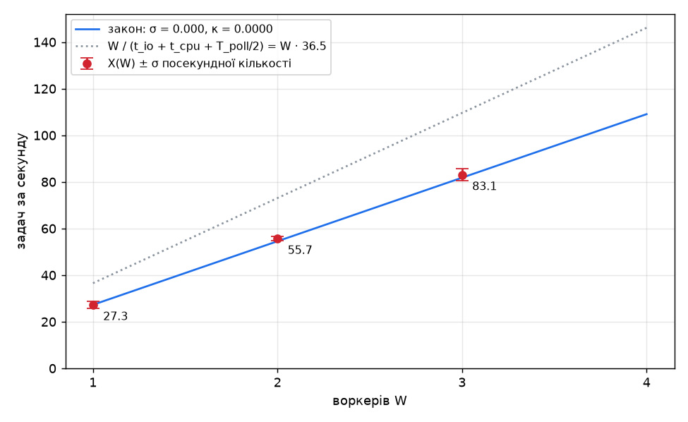
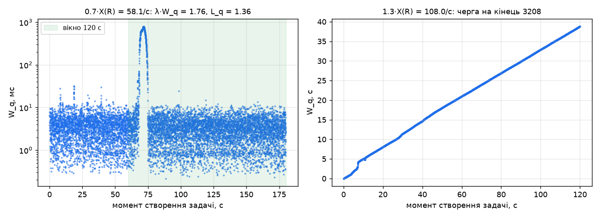
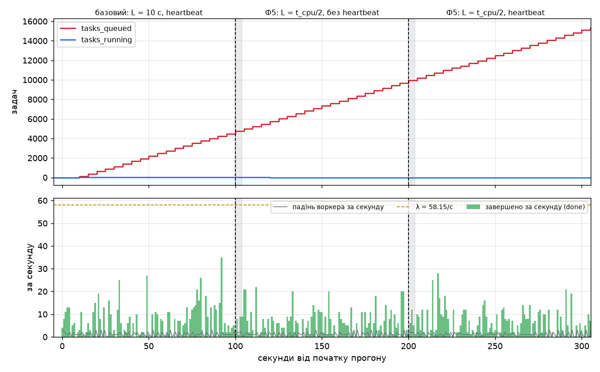
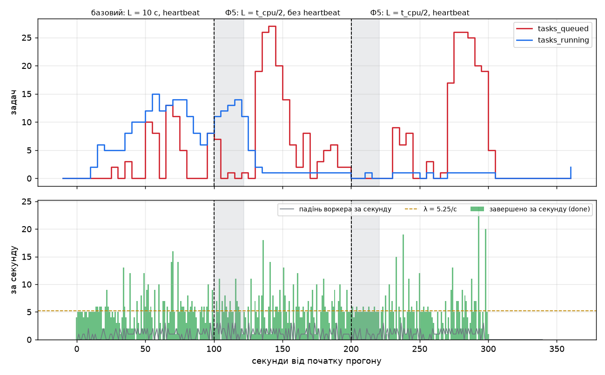

# Лабораторна робота №4. Синхронізація пула воркерів

Варіант 18.
* Сутність і ресурс: партії вакцин, `/vaccine-lots` (з ЛР1).
* Найбільша кількість воркерів: R = 3 (з ЛР3).
* Квантилі вікна яскравості: q_lo / q_hi = 0.01 / 0.99, розмір зрізу S = 256.
* Інтервал опитування: T_poll = 10 мс.
* Тривалість lease: L = 10 с, heartbeat кожні L / 3 ≈ 3.3 с.
* Сценарій відмови: Ф5 - L дорівнює половині t_cpu, прогін без heartbeat, далі з heartbeat.
* Додаткова вимога: Д6 - скасування задачі через `DELETE /tasks/{id}`.

## Структура проєкту
* `app/tasks/` - ендпоінти задач, gauges `tasks_queued` і `tasks_running` (оновлення з бази кожні 5 с).
* `worker/` - воркер окремим процесом з власним образом (`.docker/worker.Dockerfile`): `queue.py` - усі SQL черги, `slice.py` - генерація і обробка зрізу, `main.py` - цикл, heartbeat, SIGTERM, метрики.
* `db/schema.sql` - схема (застосовує Job міграції), `db/modes/` - тимчасові зміни схеми для кроків 3-4.
* `k8s/worker/worker.yaml` - ConfigMap і Deployment воркера, `k8s/monitoring/worker-podmonitor.yaml` - збір метрик.
* `loadgen/` - генератор задач (`tasks.py`), сценарії кроків (`steps.py`), розрахунки і діаграми (`analyze.py`).
* `results/` - сирі дані кожного кроку (таблиці `tasks.csv`, `results.csv`, журнали воркерів, `summary.json`), `results/rejected/` - відкинуті прогони.

## Хід роботи

### Крок 1. Схема і ендпоінти
Міграція (той самий Job, що в ЛР3) додає таблицю `tasks` з полями завдання, зовнішнім ключем `record_id → vaccine_lots(id)`, `max_attempts = 3`, `token = 0` і індексом `(status, created_at)`. Таблиця `task_results` має первинний ключ `task_id`, токен, воркер, `result jsonb` і час запису. Для Д6 додано статус `cancelled` і поле `cancel_requested_at`.

Ендпоінти (вивід `checks/api.sh`, `results/checks/api.txt`):
* `POST /vaccine-lots/{id}/tasks` - 202 і тіло задачі, 404 для неіснуючої партії. Seed генерує сервіс, вставка виконується одним `INSERT ... SELECT FROM vaccine_lots`, тому перевірка існування і вставка атомарні.
* `GET /tasks/{id}` - задача разом з результатом, 200 / 404.
* `GET /tasks?status=&limit=&offset=` - сторінка задач з фільтром за статусом; невідомий статус дає 400.
* `DELETE /tasks/{id}` (Д6) - див. крок 10.

`/metrics` сервісу web віддає `tasks_queued`, `tasks_running` і допоміжний `tasks_by_status{status}`.

### Крок 2. Воркер і час кроків
Воркер написаний на Python без NumPy: генерація зрізу лінійним конгруентним генератором, гістограма на 4096 рівнів, пошук p_lo і p_hi за кумулятивною гістограмою, перетворення кожного пікселя з округленням до найближчого цілого. Обробка розбита на три проходи (генерація, гістограма, вікно); між проходами воркер перевіряє, чи задача ще належить йому і чи не просили її скасувати.

Метрики воркера: `worker_tasks_total{result}` (done, failed, lost, а також cancelled і returned), `worker_claims_total{result}` (task, empty), гістограма `worker_task_duration_seconds{step}` (claim, fetch, process, store), `worker_tasks_in_flight`, допоміжні `worker_stale_updates_total{op}` і `worker_reaped_total{to}`. `WORKER_ID` береться з імені пода через Downward API.

20 задач на одному воркері (2 задачі за секунду, воркер не завантажений):

| величина | значення |
|---|---|
| fetch (GET запису через web) | 1.51 мс |
| store (транзакція завершення і результату) | 1.27 мс |
| **t_io** = fetch + store | **2.78 мс** |
| **t_cpu** (обробка зрізу), середнє / медіана / максимум | **19.59** / 18.69 / 24.3 мс |
| оцінка X(1) = 1 / (t_io + t_cpu + T_poll / 2) | 36.5 задач/с |

Результат детермінований: для п'яти задач p_lo, p_hi і середнє з бази збіглися з розрахунком того самого seed на хості.

Deployment `worker` без поля `replicas`: requests 250m, limits 500m CPU і 512Mi, `terminationGracePeriodSeconds: 30`, без readinessProbe (воркер не обслуговує трафік, а probe лише блокував rolling update падаючих подів, див. відкинуті рішення). Поди зібрано PodMonitor з інтервалом 5 с.

Генератор (`loadgen/tasks.py`) працює у відкритому контурі: у запланований момент i / λ передає `POST /vaccine-lots/{id}/tasks` пулу з 16-32 потоків з постійними з'єднаннями, не чекаючи відповідей попередніх запитів, для випадкових партій зі ста попередньо створених, і записує для кожного запиту плановий момент, момент надсилання, відповідь та ідентифікатор задачі. Перевірка фактичної інтенсивності за всіма прогонами (`results/analysis.json`, розділ `generator`; остання неповна секунда не враховується):

| прогони | задана, задач/с | фактична, задач/с | затримка надсилання p99 / макс. | найгірша секунда, задано / надіслано | не 202 |
|---|---|---|---|---|---|
| крок 2 | 2 | 2.0 | 5.2 / 5.6 мс | 2 / 2 | 0 |
| крок 3, 6 прогонів | 100 | 99.9-100.2 | 2.6-5.0 / ≤ 9.3 мс | 100 / 100 | 0 |
| крок 4, по 100/с і миттєва черга | 100, 1500 | 100.1, 1496-1512 | ≤ 2.7 / ≤ 5.4 мс | 100 / 100, 300 / 300 | 0 |
| крок 5 | 20 | 20.0 | 5.6 / 6.8 мс | 20 / 20 | 0 |
| крок 6, заповнення черги | 400 | 399.9-400.0 | ≤ 4.5 / ≤ 22 мс | 400 / 400 | 0 |
| крок 7, 0.7 · X(R) | 58.1 | 58.1 | 4.3 / 10.9 мс | 59 / 58 | 0 |
| крок 7, 1.3 · X(R) | 108.0 | 108.0 | 2.5 / 192 мс | 108 / 105 | 0 |
| крок 8 | 58.1 | 58.1 | 4.4 / 9.3 мс | 59 / 58 | 0 |
| крок 9 (0.7 · X_f і 0.7 · X(R)) | 5.25, 58.1 | 5.3, 58.1 | ≤ 10.2 / ≤ 19.4 мс | 6 / 6, 59 / 58 | 0 |
| крок 10 | 58.1 | 58.1 | 8.3 / 10.8 мс | 59 / 58 | 0 |
| додаткова серія W = 12 (крок 4) | 3000 | 1245-1638 | 414-700 мс | 1500 / 1196 | 0 |

У всіх прогонах із заданою завданням інтенсивністю фактична інтенсивність дорівнює заданій. Виняток - лише додаткова серія на 12 воркерах, де 1500 задач треба було лише якнайшвидше покласти в чергу: 3000 запитів за секунду генератор не тягне, і черга заповнювалась 0.9-1.2 с.

### Крок 3. Наївне захоплення
`CLAIM_MODE=naive`: окремий `SELECT` найстаршої задачі, потім `UPDATE ... WHERE id = $1` без транзакції і без перевірки статусу. Результат пишеться `INSERT` без `ON CONFLICT`, первинний ключ `task_results` тимчасово замінено індексом (`db/modes/naive.sql`). Три воркери, 300 задач з інтенсивністю 100 за секунду. Серію для кожного інтервалу повторено тричі, бо дублів одиниці і розкид між прогонами великий.

| T_poll | D у прогонах (за таблицею результатів) | D середнє | D за журналами | найбільше результатів на задачу |
|---|---|---|---|---|
| 10 мс | 3.3 %, 6.3 %, 1.3 % | **3.7 %** (33 з 900) | 3.7 % | 2 |
| 1 мс | 3.3 %, 3.0 %, 4.3 % | **3.6 %** (32 з 900) | 3.6 % | 3 |

D за таблицею результатів і за журналами збігся в кожному прогоні: усі повторні виконання дійшли до запису. Інтервал опитування майже не змінив частку дублів. Пропускна здатність трьох воркерів (≈ 83 задачі/с, крок 6) нижча за 100 задач/с, тому черга весь час непорожня і воркери беруть задачі одразу після попередньої, без очікування T_poll. Вікно гонки - це час між `SELECT` і `UPDATE` (один обмін з базою, ≈ 0.3 мс), і два воркери, які закінчили задачі майже одночасно, потрапляють у нього незалежно від T_poll. З T_poll = 1 мс частіше збігаються троє воркерів одразу: є задачі, виконані тричі.

### Крок 4. Блокування рядка
Захоплення однією командою `UPDATE ... WHERE id = (SELECT ... FOR UPDATE SKIP LOCKED) RETURNING`, первинний ключ повернуто (`db/modes/strict.sql`), T_poll = 1 мс. Лічильники і гістограма захоплення знімалися прямо з `/metrics` воркерів до і після серії: серія триває ~4 с, а Prometheus збирає метрики кожні 5 с. Очікування блокувань у `pg_stat_activity` знімалися щосекунди (як у завданні) і додатково кожні 10 мс у тій самій сесії psql через `\watch`. Крім серії кроку 3 (300 задач по 100/с), кожен режим перевірено на миттєвій черзі з 300 задач і на W = 12.

| режим | серія | D | p50 / p99 захоплення | порожніх захоплень | макс. Lock щосекунди | макс. Lock кожні 10 мс | частка зрізів з очікуванням |
|---|---|---|---|---|---|---|---|
| SKIP LOCKED | 300 по 100/с | 0 | 0.31 / 1.76 мс | 959 | 0 | 0 | 0 |
| SKIP LOCKED | 300 одразу | 0 | 0.29 / 1.64 мс | 893 | 0 | 0 | 0 |
| FOR UPDATE | 300 по 100/с | 0 | 0.30 / 1.12 мс | 892 | 0 | 0 | 0 |
| FOR UPDATE | 300 одразу | 0 | 0.31 / 1.89 мс | 819 | 0 | 0 | 0 |
| SKIP LOCKED, W = 12 | 1500 за ~0.9 с | 0 | 0.36 / 6.39 мс | 4458 | 0 | 0 | 0 |
| FOR UPDATE, W = 12 | 1500 за ~1.2 с | 0 | 0.38 / **10.0** мс | 3876 | **1** | **9** | **5.0 %** |

Обидва режими усувають дублі повністю. На трьох воркерах різниці між ними немає: захоплення триває ~0.3 мс, а цикл воркера ~25-35 мс, тому два захоплення рідко перетинаються, а коли перетинаються, очікування коротше за 1 мс і щосекундний зріз його не бачить. Різниця p99 між режимами на W = 3 (1.1-1.9 мс) в межах розкиду між повторами. На 12 воркерах FOR UPDATE дає черги до 9 очікувальників, 5 % зрізів з очікуванням і більший p99, тоді як SKIP LOCKED не чекає жодного разу. Лічильник порожніх захоплень за серію включає й холосте опитування порожньої черги з інтервалом 1 мс на початку і в кінці серії, тому відрізнити за ним захоплення, що повернули порожній результат через блокування, не можна; у FOR UPDATE порожніх захоплень на 7-13 % менше, що узгоджується з тим, що заблоковане захоплення триває довше і воркер опитує чергу рідше. Далі використовується SKIP LOCKED і T_poll = 10 мс.

### Крок 5. Lease, heartbeat і fencing token
Воркер перед кожним захопленням повертає в чергу задачі зі сплилим lease (`... FOR UPDATE SKIP LOCKED`, щоб воркери не чекали один на одного), задача з `attempts >= max_attempts` переходить у `failed`. Heartbeat окремим потоком з власним з'єднанням: `UPDATE tasks SET lease_until = now() + L WHERE id = $1 AND token = $2 AND status = 'running'`. Завершення - одна транзакція: `UPDATE ... SET status = 'done' WHERE id = $1 AND token = $2 RETURNING`, і лише якщо рядок оновлено, `INSERT INTO task_results ... ON CONFLICT (task_id) DO NOTHING`.

Перевірка на 2 воркерах, 100 задач. `kubectl exec <pod> -- kill -STOP 1` не зупиняє воркер (див. відкинуті рішення), тому той самий сигнал тому самому процесу надсилався з вузла kind: `docker exec lab4-worker kill -STOP <pid>`. Під час зупинки `/proc/<pid>/status` показував `State: T (stopped)`.

| момент | що відбулося (журнали воркерів і таблиця tasks) |
|---|---|
| 22:21:47.377 | `worker-…-655gv` захопив задачу 68: attempts 1, token 1, lease до 22:21:57.377; одразу після цього SIGSTOP |
| 22:21:57.383 | lease сплив, `worker-…-8ss48` повернув задачу в чергу (`event=reaped to=queued`) |
| 22:21:57.384 | `8ss48` захопив її: attempts 2, token 2 |
| 22:21:57.402 | `8ss48` завершив задачу 68 і записав результат з token 2 |
| 22:22:07.5 | SIGCONT після 20.2 с зупинки (2 · L) |
| 22:22:07.557 | `655gv`: `event=stale op=heartbeat rows=0 task=68 token=1` |
| 22:22:07.565 | `655gv`: `event=stale op=store rows=0 task=68 token=1`, транзакція завершення відкотилась |

До зупинки задача 68 мала attempts 1 і token 1, після прогону - attempts 2, token 2, статус done, воркер `8ss48`. У `task_results` для неї один рядок (token 2). Усі 100 задач у статусі done.

### Крок 6. Пропускна здатність пулу
Перед кожним прогоном воркери зупинено (`replicas=0`), чергу заповнено через API, потім `kubectl scale --replicas=W`. 400 задач трьома воркерами обробляються за 5 с, тому для вікна 30 с з запасом кількість задач обрано як 60 · W · 36.5 (≈ 80 с обробки). X(W) рахувався за `finished_at` з таблиці за останні 30 с до спорожнення черги (момент останнього захоплення). CPU і кількість транзакцій бази - за 60 с перед спорожненням, бо cAdvisor оновлює лічильники кожні ~15 с і в 30-секундне вікно потрапляють 1-2 значення.

| W | задач | X(W), задач/с | σ посекундно | p99 захоплення | транзакцій бази/с | CPU бази | CPU воркерів | періодів з тротлінгом | обробка p50 |
|---|---|---|---|---|---|---|---|---|---|
| 1 | 2192 | **27.3** | 1.5 | 1.64 мс | 229 | 0.035 | 0.50 | 100 % | 40.1 мс |
| 2 | 4384 | **55.7** | 1.0 | 1.61 мс | 451 | 0.066 | 1.00 | 100 % | 31.2 мс |
| 3 | 6576 | **83.1** | 2.6 | 1.58 мс | 669 | 0.087 | 1.50 | 99 % | 30.5 мс |

X(1) = 27.3 нижча за оцінку 1 / (t_io + t_cpu + T_poll / 2) = 36.5 з двох причин. По-перше, t_cpu кроку 2 виміряно на незавантаженому воркері, який отримує ціле ядро на короткі сплески; під безперервною роботою воркер витрачає рівно свій ліміт 0.5 ядра, майже кожен період CFS закінчується тротлінгом, і обробка зростає до 30-40 мс. Ліміт дає стелю 0.5 / 0.0183 ≈ 27 задач/с при ~18 мс CPU на задачу, що збігається з виміряним. По-друге, член T_poll / 2 при непорожній черзі не діє: захоплення одразу повертає задачу.

Відносна пропускна здатність C(2) = 2.04, C(3) = 3.05. За формулами ЛР2 (W замість N): Σu² = 5, Σv² = 40, Σuv = 14, Σuy = -0.0509, Σvy = -0.1322, знаменник 4. Двопараметрична оцінка σ = (40 · (-0.0509) - 14 · (-0.1322)) / 4 = -0.046 і κ = 0.013; σ < 0, тому σ = 0 і κ = Σvy / Σv² = -0.0033; κ < 0, тому κ = 0. Отже σ = κ = 0, і W* не визначене: у межах 1-3 воркерів пул масштабується лінійно (C(W) трохи більше за W - похибка вимірювання). Спільний ресурс - база - на трьох воркерах завантажена на 0.087 ядра при ~8 транзакціях на задачу (7 очікуваних: повернення сплилих lease, захоплення, читання запису сервісом web, три перевірки між проходами, транзакція завершення; решта - фонові запити експортера і gauges); насичення бази слід очікувати на порядок далі за R.

*Рисунок 1 - X(W) з розкидом посекундної кількості, крива закону масштабованості і оцінка W / (t_io + t_cpu + T_poll / 2)*

### Крок 7. Закон Літтла
Три воркери, 0.7 · X(R) = 58.1 задач/с протягом 180 с, вікно - останні 120 с.

| величина | значення |
|---|---|
| λ (створено за секунду у вікні) | 58.07 |
| W_q = середнє started_at - created_at | 30.31 мс (p50 2.94 мс, p99 703 мс) |
| λ · W_q | **1.760** |
| L_q, середнє `tasks_queued` (25 значень через 5 с) | **1.36** |
| розбіжність | **-22.7 %** |
| L_q, середнє за часовими мітками задач | 1.760 |

Між 66 і 76 секундою всі три воркери одночасно сповільнилися приблизно на третину (14 задач/с на воркер замість 19-20, найдовше виконання 190 мс): це конкуренція за процесор хоста, а не поведінка черги. За ці секунди черга виросла до 47 задач (за часовими мітками; gauge встиг побачити 23), і саме ці задачі дають середнє W_q 30 мс; без них W_q = 3.3 мс. Gauge оновлюється раз на 5 с, тож за вікно маємо 25 миттєвих значень, з яких 20 нульові і одне потрапило на пік (23). Середнє за часовими мітками задач дорівнює λ · W_q точно, бо це та сама площа під кривою довжини черги; розбіжність -23 % - похибка вибірки gauge, а не порушення закону. Окремо: у спокійні секунди W_q ≈ 3.3 мс менше за T_poll / 2 = 5 мс, бо при завантаженні 0.7 зазвичай вільні два воркери, які опитують чергу незалежно, і очікування близьке до T_poll / 3.

Перевантаження 1.3 · X(R) = 108 задач/с протягом 120 с: на кінець прогону в черзі **3208** задач (оцінка (108 - 83.1) · 120 ≈ 2990). W_q перших 100 задач - **0.11 с**, останніх 100 - **38.7 с** (3208 / 83.1 = 38.6 с). Черга росте лінійно, і час очікування росте разом з нею.

*Рисунок 2 - W_q кожної задачі за моментом створення: ліворуч 0.7 · X(R) (шкала логарифмічна, зелене - вікно 120 с), праворуч 1.3 · X(R)*

### Крок 8. Коректна зупинка
Після SIGTERM воркер перестає захоплювати задачі, дописує поточну і виходить з кодом 0. Окремий потік стежить за дедлайном `GRACE_SECONDS = 25` (менше за `terminationGracePeriodSeconds: 30`): якщо задача не завершилась, він виконує `UPDATE tasks SET status = 'queued' WHERE id = $1 AND token = $2` і виходить.

`kubectl rollout restart deployment/worker` під 0.7 · X(R) протягом 90 с:

| величина | значення |
|---|---|
| коди завершення трьох старих контейнерів | 0, 0, 0 (`Completed`) |
| SIGTERM під час обробки | 1 з 3 (задача 2444 дописана, вихід через 6 мс) |
| повернуто в чергу воркерами | 0 |
| задач у статусі failed | 0 |
| задач з більше ніж одним результатом | 0 |
| задач з attempts > 1 | 0 з 5233 |

Задача триває ~20 мс, тому до повернення в чергу справа не доходить. Щоб перевірити саму гілку повернення, окремо запущено прогін зі зрізом 2048 × 2048 (~2.3 с на задачу), `GRACE_SECONDS = 0.5` і чергою, що росте (3 задачі/с): усі три воркери отримали SIGTERM з задачею в обробці, двоє дописали її за 0.5 с, третій повернув задачу 27 (`event=returned rows=1`) і вийшов з кодом 0. Задачу 27 дообробив інший воркер з attempts 2, результат у неї один.

### Крок 9. Вбудоване падіння і сценарій Ф5
`FAIL_RATE = 0.15`: після обробки і до запису результату воркер з цією імовірністю виконує `os._exit(1)`. Задача 20 мс і падіння в середньому кожні 6-7 задач означають, що контейнер працює ~0.2 с між перезапусками.

Стандартний backoff kubelet (10 с, далі вдвічі до 5 хв) за 90 с поклав усі три поди в `CrashLoopBackOff`: **0.7 задач/с** замість 83 (`results/rejected/fail_rate_default_backoff`). Тому в конфігурації kubelet задано `crashLoopBackOff.maxContainerRestartPeriod: 1s` (функція `KubeletCrashLoopBackOffMax`, beta у 1.37; `k8s/kind-config.yaml`). Навіть так ємність пулу з падіннями X_f = **7.5 задач/с** - 9 % від X(R) = 83.1 (124 падіння за 90 с, `results/step9_capacity`): кожен под падав у середньому раз на 2.2 с, з яких робота - ~0.2 с (5-6 задач), решта - backoff і старт Python.

Тому крок 9 виконано двічі, обидва рази 300 с на R = 3 воркерах зі сценарієм Ф5 у середині: на 100-й секунді `kubectl set env LEASE_SECONDS=0.0098 HEARTBEAT=0` (L = t_cpu / 2 = 19.59 / 2 мс), на 200-й - `HEARTBEAT=1` (heartbeat кожні 3.3 мс).

**Прогін за завданням, λ = 0.7 · X(R) = 58.1 задач/с** (`results/step9_literal`). Пул обробляє 6.1-6.7 задач/с, черга росте весь прогін і на кінець має **15 444** задачі; після прогону її очищено, а не дочекано (на 7.5 задач/с це ~35 хв). Перемикання сценарію - 3.6 с. Оскільки кожна фаза обробляє задачі, створені раніше, задачі віднесено до фази за моментом завершення (done або failed).

| фаза | завершено задач | attempts 1 / 2 / 3 | частка attempts > 1 | failed | частка failed | рядків «0 rows» (op) | падінь | X done |
|---|---|---|---|---|---|---|---|---|
| L = 10 с, heartbeat | 668 | 578 / 80 / 10 | **13.5 %** | 2 | **0.30 %** | 0 | 114 | 6.65/с |
| Ф5: L = 9.8 мс, без heartbeat | 601 | 468 / 91 / 42 | **22.1 %** | 8 | **1.33 %** | **69** (check 19, store 50) | 106 | 6.15/с |
| Ф5: L = 9.8 мс, heartbeat | 626 | 505 / 86 / 35 | **19.3 %** | 5 | **0.80 %** | **120** (heartbeat 70, check 20, store 30) | 108 | 6.43/с |
| очікування від FAIL_RATE | | | f = 15 % | | f³ = 0.34 % | 0 | | |

X у цьому прогоні - **6.4 задач/с**, тобто 7.7 % від X(R) = 83.1 без падінь. Перезапуски: RESTARTS у `kubectl get pods` перед кожним перемиканням і в кінці - 112 + 109 + 110 = 331; спостерігач за контейнерами зафіксував 352 завершення з кодом 1 (поди, видалені під час rolling update, встигли впасти ще раз після знімка), у журналах - 350 рядків `event=crash` (двох контейнерів, що двічі перезапустились між опитуваннями збирача журналів, у журналі немає). Задач з більше ніж одним результатом - 0. Доля attempts > 1 у базовій фазі нижча за f, ймовірно, тому що серед завершених за 100 с задач недостатньо представлені ті, що чекали повторного захоплення 10 с lease у черзі з тисяч задач.

*Рисунок 3 - прогін за завданням (0.7 · X(R)): tasks_queued і tasks_running, завершені задачі і падіння за секунду; пунктир - перемикання сценарію*

**Прогін з λ = 0.7 · X_f = 5.25 задач/с** (`results/step9`). Тут черга стала, кожна задача завершується в межах прогону, і задачі віднесено до фази за моментом створення - це чисте порівняння фаз Ф5. Перемикання сценарію в цьому прогоні йшло ще з readinessProbe і займало ~21 с; секунди rolling update не враховано.

| фаза | задач | attempts 1 / 2 / 3 | частка attempts > 1 | failed | частка failed | рядків «0 rows» (op) | падінь | X done |
|---|---|---|---|---|---|---|---|---|
| L = 10 с, heartbeat | 525 | 440 / 74 / 11 | **16.2 %** | 2 | **0.38 %** | 0 | 92 | 5.11/с |
| Ф5: L = 9.8 мс, без heartbeat | 411 | 286 / 74 / 51 | **30.4 %** | 8 | **1.95 %** | **104** (check 21, store 83) | 89 | 5.30/с |
| Ф5: L = 9.8 мс, heartbeat | 417 | 333 / 63 / 21 | **20.1 %** | 4 | **0.96 %** | **72** (heartbeat 54, check 9, store 9) | 90 | 5.20/с |
| очікування від FAIL_RATE | | | f = 15 % | | f³ = 0.34 % | 0 | | |

Загалом за прогін: 1559 done, 16 failed, жодної задачі з більше ніж одним результатом. Перезапуски: стовпчик RESTARTS у `kubectl get pods` перед кожним перемиканням і в кінці - 91 + 102 + 99 = 292; спостерігач за контейнерами зафіксував 319 завершень з кодом 1 (поди, видалені під час rolling update, встигли впасти ще раз після знімка) і рівно 319 рядків `event=crash` у журналах.

В обох прогонах картина однакова. У базовій фазі сталого прогону частка attempts > 1 і частка failed збігаються з f і f³. Падіння не дає рядків «0 rows»: процес зникає, і задачу забирає інший воркер після lease. З L = t_cpu / 2 без heartbeat lease спливає посеред обробки майже кожної задачі; вільний воркер, що опитує чергу кожні 10 мс, встигає повернути і захопити її, тому частка повторних захоплень подвоюється, а старий власник отримує 0 оновлених рядків на перевірці між проходами або на записі. Heartbeat кожні 3.3 мс прибирає більшу частину зайвих захоплень і failed, але не все (при черзі з тисяч задач рядків «0 rows» з heartbeat навіть більше: heartbeat раніше помічає втрату задачі, ніж перевірка між проходами, і воркер кидає її до запису): між двома heartbeat інколи проходить більше 9.8 мс, бо потоку heartbeat треба дочекатися GIL від потоку обробки (інтервал перемикання 5 мс) і зрізу CFS. Lease має бути на порядки довшим за затримки планування, а не за тривалість задачі. Водночас короткий lease прибрав зависання упалих задач: у базовій фазі `tasks_running` доходить до 15 - упалі задачі чекають 10 с, у фазах Ф5 після rolling update - 1-2.

*Рисунок 4 - прогін з 0.7 · X_f: tasks_queued і tasks_running (gauges web), завершені задачі і падіння воркерів за секунду; пунктир - момент перемикання сценарію, сіре - rolling update*

### Крок 10. Додаткова вимога Д6: скасування задачі
`DELETE /tasks/{id}` однією командою: задача у `queued` одразу переходить у `cancelled` (200), для `running` виставляється `cancel_requested_at` (202), завершена задача дає 409, неіснуюча - 404. Воркер перевіряє позначку між проходами обробки (перед генерацією, після генерації, після гістограми) і на записі: `UPDATE ... SET status = CASE WHEN cancel_requested_at IS NULL THEN 'done' ELSE 'cancelled' END`, результат пишеться лише для `done`. Повернення сплилого lease переводить задачу з позначкою в `cancelled`, а не в чергу.

| перевірка | результат |
|---|---|
| 20 задач у queued (воркери зупинені) | 20 × 200, усі `cancelled`, attempts 0, результатів 0; після запуску воркерів так і лишились |
| 20 задач у running (0.7 · X(R)) | 20 × 202, усі `cancelled`, результатів 0, усі зупинені на межі проходів |
| від запиту до зупинки обробки (`finished_at - cancel_requested_at`) | **p50 4.3 мс, p99 5.3 мс**, мінімум 1.8 мс |

Час зупинки обмежений тривалістю проходу: обробка ~20 мс розбита на три проходи по ~6-7 мс, і скасування спрацьовує на найближчій межі, тобто швидше за один прохід.

## Відхилення від завдання
1. **`kubectl exec ... -- kill -STOP 1` (крок 5)**: процес з PID 1 є init свого PID namespace, і ядро доставляє йому зсередини namespace лише сигнали, для яких встановлено обробник; SIGSTOP серед них бути не може. Після команди `/proc/1/status` лишався `S (sleeping)`. Той самий сигнал тому самому процесу надіслано з вузла kind (предок namespace).
2. **400 задач у кроці 6**: три воркери обробляють їх за 5 с, тому взято 60 · W · X(1)оцінка задач, щоб черга була непорожньою щонайменше 60 с.
3. **Крок 9**: прогін за завданням (0.7 · X(R)) виконано, але черга в ньому не спорожняється, тому статистику фаз рахує за завершеними задачами; для чистого порівняння фаз Ф5 додано прогін з 0.7 · X_f.
4. **Backoff kubelet**: обмежено 1 с, причина - крок 9.

## Відкинуті рішення
1. **Стандартний backoff перезапусків**: з FAIL_RATE = 0.15 і задачею 20 мс пул зупиняється (0.7 задач/с за 90 с).
2. **SIGSTOP під час запису результату**: у першій спробі кроку 5 воркер зупинився всередині транзакції завершення (`store_ms = 20176`). Рядок лишався заблокованим 20 с, повернення lease з `SKIP LOCKED` його пропускало, і після SIGCONT задачу завершив той самий воркер (`results/rejected/step5_stopped_inside_store_transaction`). Lease не допомагає, коли власник тримає відкриту транзакцію; від цього захищає `idle_in_transaction_session_timeout`. Для основного прогону воркер ловили на кроці обробки: після SIGSTOP рядок його задачі мав читатися через `FOR UPDATE SKIP LOCKED`.
3. **Лічильники з Prometheus для серій по 4 с**: інтервал збору 5 с дає дельти, менші за кількість задач (119 захоплень замість 300). Метрики читаються з `/metrics` воркерів через проксі API-сервера; варіант з `kubectl exec python` усередині пода забирав частину квоти CPU воркера і завищував p99 захоплення.
4. **Вікно 30 с для CPU з cAdvisor**: 1-2 значення у вікні, CPU воркера виходив 0.32 ядра при 100 % тротлінгу; замінено `rate()` за 60 с.
5. **Збір журналів через `kubectl logs -f`**: команда віддає весь журнал контейнера, і в результати потрапили задачі попереднього прогону; додано `--since-time` від початку прогону.
6. **readinessProbe у воркера**: падаючий под не встигав стати Ready, і `rollout status` / перемикання сценарію в кроці 9 зависали; воркер не стоїть за Service, тому probe прибрано (перемикання скоротилось з ~21 с до 3.6 с).
7. **Хостові порти 8080 і 9090**: 8080 зайнятий іншим контейнером Docker, кластер використовує 8084 і 9094.

## Висновки
Наївне захоплення двома командами дає 3.6-3.7 % дублів незалежно від інтервалу опитування: гонка відбувається в момент, коли кілька воркерів одночасно звільняються, а не під час очікування. Захоплення однією командою з `FOR UPDATE` усуває дублі; `SKIP LOCKED` додатково прибирає очікування на рядку, що стає помітним лише тоді, коли захоплення різних воркерів перетинаються - на 12 воркерах, а не на трьох.

Lease з fencing token працює як задумано: зупинений на 2 · L воркер повертається з застарілим токеном, його heartbeat і запис оновлюють нуль рядків, і результат лишається один. Межі механізму видно з двох боків: відкрита транзакція утримує задачу понад lease, а lease, коротший за затримки планування потоку heartbeat, дає хибні перехоплення навіть з heartbeat.

Пул масштабується лінійно (σ = κ = 0): кожен воркер упирається у свій ліміт 0.5 ядра, база завантажена слабо. Закон Літтла виконується за часовими мітками задач; середнє gauge з оновленням раз на 5 с при середній довжині черги близько двох задач має похибку в десятки відсотків. Найдорожчим виявилося вбудоване падіння: при задачі в 20 мс перезапуск контейнера в сто разів довший за задачу, тож навіть з backoff 1 с пул з FAIL_RATE = 0.15 має 9 % своєї пропускної здатності, хоча частки повторних виконань і failed точно відповідають f і f³.
