# Лабораторна робота №1. Проєктування і розгортання CRUD-сервісу

Варіант 18: сутність - партія вакцин на складі, шлях ресурсу /vaccine-lots; обовʼязкові поля - номер партії, вакцина, кількість доз, температурний режим, дата виготовлення, термін придатності; фільтр у переліку - за вакциною; правило валідації - термін придатності пізніший за дату виготовлення, кількість доз більша за нуль. Базовий образ фінальної стадії python:3.12-slim, ліміти на контейнер сервісу 1 CPU і 512 МБ. Додаткова вимога - база у внутрішній мережі без публікації порту на хост.

## Середовище

macOS 26.4.1, Apple M3 Pro (12 ядер), Docker 27.4.0 (Docker Desktop, віртуальна машина з 12 CPU), Docker Compose 2.31. Сервіс - Python 3.12, FastAPI 0.143, uvicorn 0.54 (uvloop, httptools), драйвер asyncpg 0.32, pydantic 2.14; база PostgreSQL 17 (postgres:17-alpine); балансувальник nginx 1.28 (nginx:1.28-alpine). Генератор навантаження - Python 3.14 лише на стандартній бібліотеці, запускається на хості. Генератор і стенд працюють на одній машині, і на ній же працювали інші застосунки: навіть на 10 rps процесор хоста був зайнятий на 27%, тож на верхніх рівнях генератор, віртуальна машина Docker і сторонні процеси конкурують за ядра.

## Хід роботи

### Етап 1. Проєктування

Схему таблиці (db/schema.sql) і формати запитів написано першими, до коду сервісу; таблиці нижче описують саме цей проєкт.

#### Схема таблиці (db/schema.sql)

Сутність лежить в одній таблиці vaccine_lots:

| Поле | Тип | Обовʼязкове | Обмеження і чому такий тип |
|---|---|---|---|
| id | BIGINT GENERATED ALWAYS AS IDENTITY | так | первинний ключ; генерує база, клієнт його не передає; BIGINT не переповниться |
| lot_number | VARCHAR(32) | так | UNIQUE; номер партії - короткий код виробника, текст, бо містить літери і дефіси |
| vaccine | VARCHAR(100) | так | назва вакцини; поле фільтра |
| doses | INTEGER | так | CHECK (doses > 0); ціла кількість доз, INTEGER вистачає з великим запасом |
| temperature_regime | VARCHAR(16) | так | CHECK зі списку '+2..+8', '-25..-15', '-90..-60' - три реальні режими холодового ланцюга |
| manufactured_on | DATE | так | дата без часу, бо виробник вказує саме дату |
| expires_on | DATE | так | CHECK (expires_on > manufactured_on) |
| created_at | TIMESTAMPTZ | так | DEFAULT now(); час створення запису |
| updated_at | TIMESTAMPTZ | так | DEFAULT now(); оновлюється при PUT |

Індекси: первинний ключ за id (вимірюваний запит GET за ідентифікатором), унікальний індекс vaccine_lots_lot_number_key за lot_number (номер партії не може повторюватись, дублікат дає 409) і складений індекс vaccine_lots_vaccine_id_idx за (vaccine, id), який обслуговує і фільтр за вакциною, і сортування за id при пагінації. Правила варіанта продубльовано в CHECK-обмеженнях бази, щоб жоден клієнт в обхід сервісу не записав некоректну партію; основна валідація з поясненням виконується в сервісі.

Схема накочується автоматично: файл db/schema.sql змонтовано в /docker-entrypoint-initdb.d контейнера бази, і PostgreSQL виконує його при першому старті з порожнім томом.

#### API

Тіло партії для POST і PUT однакове, всі шість полів обовʼязкові, зайві поля відхиляються:

```json
{"lot_number": "LOT-2609-V018", "vaccine": "Vaxigrip Tetra", "doses": 600,
 "temperature_regime": "+2..+8", "manufactured_on": "2026-09-01", "expires_on": "2027-06-30"}
```

Відповідь із записом - те саме плюс id, created_at, updated_at. Помилка валідації - 400 з переліком полів:

```json
{"error": "validation failed", "details": [
  {"field": "doses", "message": "Input should be greater than 0"},
  {"field": "expires_on", "message": "must be later than manufactured_on (2026-09-01)"}]}
```

| Ендпоінт | Тіло запиту | Тіло відповіді | Коди відповідей |
|---|---|---|---|
| POST /vaccine-lots | партія | створений запис з id | 201 створено; 400 невалідні дані; 409 lot_number уже існує |
| GET /vaccine-lots?vaccine=&limit=&offset= | - | {"items": [...], "total": N, "limit": L, "offset": O} | 200; 400 невалідні vaccine/limit/offset |
| GET /vaccine-lots/{id} | - | запис | 200; 404 немає запису; 400 id не ціле число від 1 до 2^63-1 |
| PUT /vaccine-lots/{id} | партія (повна) | оновлений запис | 200; 404 немає запису; 400 невалідні дані або id; 409 конфлікт lot_number |
| DELETE /vaccine-lots/{id} | - | порожнє | 204 видалено; 404 немає запису (і при повторному DELETE); 400 невалідний id |
| GET /healthz | - | {"status": "ok", "instance": ...} | 200 база відповідає на SELECT 1; 503 база недоступна |

Для GET /{id} умова передбачає 200 або 404; 400 тут додано лише для id, який не може бути ідентифікатором взагалі (рядок, нуль, число поза BIGINT): такий запит невалідний, а не «запис не знайдено», і без перевірки він дійшов би до бази і повернувся б як 500.

Пагінація: limit за замовчуванням 20, верхня межа 100 (limit=500 дає 400), offset від 0. Перелік без фільтра повертає всі записи з урахуванням пагінації, total - загальна кількість за фільтром; total і сторінка читаються в одній транзакції REPEATABLE READ, тож не розходяться під конкурентним записом. Кожна відповідь сервісу несе заголовок X-Instance з іменем контейнера - за ним генератор рахує, який інстанс обслужив запит.

### Етап 2. Сервіс (app/)

Сервіс розкладено за шарами всередині пакета домену app/vaccine_lots:

| Модуль | Що робить |
|---|---|
| app/vaccine_lots/schemas.py | DTO: VaccineLotIn (тіло запиту з правилами варіанта), VaccineLotOut, VaccineLotPage |
| app/vaccine_lots/repository.py | VaccineLotRepository - лише SQL через asyncpg |
| app/vaccine_lots/service.py | VaccineLotService - логіка і перетворення записів бази на DTO; LotNotFound, якщо запису немає |
| app/vaccine_lots/router.py | ендпоінти; сервіс приходить через Depends (dependencies.py) |
| app/vaccine_lots/exceptions.py | LotNotFound (404), LotNumberTaken (409) |
| app/main.py | збирання застосунку, middleware X-Instance, обробники помилок |
| app/config.py, app/database.py, app/health.py | налаштування зі змінних середовища, пул з очікуванням бази, /healthz |

Валідацію робить DTO VaccineLotIn: StrictInt для doses (рядок "5" не пройде) з межами 1..2^31-1 під тип INTEGER, Literal для температурного режиму, заборона символу NUL у текстових полях (PostgreSQL його не приймає), валідатор expires_on порівнює дату з manufactured_on. Межі для id і offset (до 2^63-1) задано в параметрах шляху і запиту. Стандартну відповідь FastAPI 422 замінено обробником, який повертає 400 зі списком {field, message}; на випадок, якщо якесь значення все ж не влізе в тип колонки, asyncpg.DataError теж перетворюється на 400. Тобто помилка бази назовні як 500 не виходить: число 3000000000 у doses, id 99999999999999999999 або NUL у назві дають 400 з поясненням.

Сервіс не тримає стану в памʼяті, усе лежить у базі. На старті він у циклі пробує створити пул підключень (до 10 на інстанс), поки база не відповість, максимум 60 с; якщо база так і не піднялась, процес завершується, і політика restart: unless-stopped перезапускає контейнер. Поки пул не створено, uvicorn порт не слухає, а nginx стартує лише після того, як сервіс став healthy, тому в перші секунди після docker compose up порт 8018 ще закритий. Після завершення docker compose up -d (Compose чекає весь ланцюжок healthcheck) будь-який запит отримує відповідь, а не помилку підключення. /healthz виконує SELECT 1 з тайм-аутом 1 с і повертає 503, якщо база недоступна (рис. 1).

Сервіс перевіряли зі стендом у контейнерах (база в контейнері) через curl і checks/verify.py, окремо без Docker його не запускали.

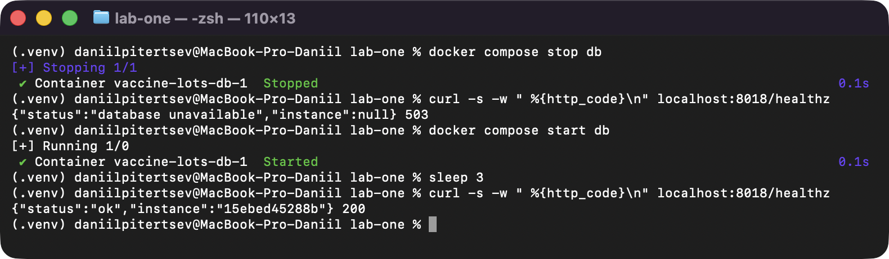

*Рисунок 1 - /healthz при зупиненій базі повертає 503, після запуску бази - 200*

### Етап 3. Образ (.docker/Dockerfile, .dockerignore)

Збірка двоетапна. Стадія build на python:3.12-slim створює віртуальне середовище /opt/venv і ставить у нього залежності з requirements.txt (усі вони встановлюються з уже скомпільованих пакетів для linux/arm64, компілятор не потрібен). Фінальна стадія - знову python:3.12-slim (базовий образ варіанта): у неї копіюється лише готове /opt/venv і пакет app/, без кешу pip і без засобів збірки. Процес працює від користувача app з uid 10001. Healthcheck зроблено через python і urllib, бо в slim-образі немає curl. Uvicorn тримає keep-alive 75 с - довше, ніж nginx тримає простоюючі підключення (30 с), інакше під навантаженням виникала гонка (див. «Відкинуті рішення», п. 7).

```dockerfile
FROM python:3.12-slim AS build

ENV PIP_NO_CACHE_DIR=1 PIP_DISABLE_PIP_VERSION_CHECK=1
RUN python -m venv /opt/venv
COPY requirements.txt /tmp/requirements.txt
RUN /opt/venv/bin/pip install -r /tmp/requirements.txt

FROM python:3.12-slim

ENV PATH=/opt/venv/bin:$PATH PYTHONDONTWRITEBYTECODE=1 PYTHONUNBUFFERED=1
RUN groupadd --system --gid 10001 app && useradd --system --uid 10001 --gid app --no-create-home app
COPY --from=build /opt/venv /opt/venv
WORKDIR /srv
COPY app/ ./app/
USER app
EXPOSE 8000
HEALTHCHECK --interval=2s --timeout=2s --start-period=5s --retries=3 \
    CMD ["python", "-c", "import sys, urllib.request; sys.exit(0 if urllib.request.urlopen('http://127.0.0.1:8000/healthz', timeout=2).status == 200 else 1)"]
CMD ["uvicorn", "app.main:app", "--host", "0.0.0.0", "--port", "8000", "--no-access-log", "--timeout-keep-alive", "75", "--loop", "uvloop", "--http", "httptools"]
```

Dockerfile лежить у теці .docker/ разом із конфігурацією nginx, а docker-compose.yml і .dockerignore - у корені. Контекст збірки - корінь репозиторію (build.context: ., dockerfile: .docker/Dockerfile), тому діє кореневий .dockerignore. Він працює як білий список: у контекст збірки потрапляють лише requirements.txt і файли .py пакета app, тож .env, результати і генератор в образ не потрапляють ні за яких умов.

```text
*
!requirements.txt
!app/*.py
!app/**/*.py
```

Пароля немає ні в образі, ні в історії збірки: жодна інструкція Dockerfile не згадує DB_PASSWORD, значення приходить лише під час запуску контейнера.

Розмір фінального образу vaccine-lots-web:1.0 - 211.4 МБ (docker image inspect, 211 МБ у docker images, results/image_size.txt). За docker history (results/image_layers.txt) шар із віртуальним середовищем займає 66.8 МБ, код сервісу - 12.8 кБ, решта - базовий python:3.12-slim.

### Етап 4. Стенд (docker-compose.yml, .docker/nginx/nginx.conf)

```yaml
name: vaccine-lots

services:
  db:
    image: postgres:17-alpine
    environment:
      POSTGRES_USER: vaccines
      POSTGRES_DB: vaccines
      POSTGRES_PASSWORD: ${POSTGRES_PASSWORD:?set POSTGRES_PASSWORD in .env}
    volumes:
      - db-data:/var/lib/postgresql/data
      - ./db/schema.sql:/docker-entrypoint-initdb.d/01-schema.sql:ro
    healthcheck:
      test: ["CMD-SHELL", "pg_isready -h 127.0.0.1 -U vaccines -d vaccines"]
      interval: 1s
      timeout: 2s
      retries: 30
    networks:
      - backend

  web:
    build:
      context: .
      dockerfile: .docker/Dockerfile
    image: vaccine-lots-web:1.0
    restart: unless-stopped
    environment:
      DB_HOST: db
      DB_PORT: 5432
      DB_USER: vaccines
      DB_NAME: vaccines
      DB_PASSWORD: ${POSTGRES_PASSWORD:?set POSTGRES_PASSWORD in .env}
      DB_POOL_MAX: 10
    expose:
      - "8000"
    depends_on:
      db:
        condition: service_healthy
    deploy:
      replicas: ${WEB_REPLICAS:-1}
      resources:
        limits:
          cpus: "1"
          memory: 512M
    networks:
      - backend
      - frontend

  lb:
    image: nginx:1.28-alpine
    ports:
      - "${LB_PORT:-8018}:80"
    volumes:
      - ./.docker/nginx/nginx.conf:/etc/nginx/nginx.conf:ro
    depends_on:
      web:
        condition: service_healthy
    networks:
      - frontend

volumes:
  db-data:

networks:
  frontend:
  backend:
    internal: true
```

Що виконано з вимог:
- три сервіси: база, вебінстанс, балансувальник; порт на хост публікує лише lb (8018 -> 80), web має тільки expose, db - нічого;
- кількість вебінстансів задається одним параметром WEB_REPLICAS (deploy.replicas), блок сервісу не копіюється: docker compose up -d піднімає один інстанс, WEB_REPLICAS=2 docker compose up -d - два, без правок у файлах;
- том db-data під дані бази, схема накочується з db/schema.sql;
- healthcheck бази (pg_isready через TCP, -h 127.0.0.1, бо перевірка через unix-сокет проходить ще на тимчасовому сервері, який PostgreSQL піднімає на час init-скриптів) і сервісу; web стартує лише після service_healthy бази, lb - після service_healthy сервісу;
- ліміти web за варіантом: cpus "1", memory 512M; restart: unless-stopped;
- пароль лише у змінній POSTGRES_PASSWORD з файлу .env; у репозиторії лежить .env.example, сам .env в .gitignore; у docker-compose.yml пароля немає - лише посилання на змінну, а :? зупиняє запуск, якщо змінну не задано.

Балансувальник: upstream web з параметром resolve - nginx 1.28 сам перевизначає імʼя web через DNS Docker (127.0.0.11) кожні 5 с, тому бачить усі репліки, скільки б їх не було. До інстансів тримаються keep-alive підключення. Журнал доступу пише адресу інстансу ($upstream_addr) - так підтверджується розподіл. location /noop відповідає 200 прямо з nginx, не торкаючись сервісу - це ендпоінт для перевірки генератора.

Запуск на порожній машині: один раз підготувати .env, далі стенд піднімається однією командою з кореня репозиторію.

```sh
cp .env.example .env
docker compose up -d --build
```

Час від docker compose up до першої відповіді 200 на /healthz (образи зібрані, том порожній, перед кожним повтором docker compose down -v; checks/startup.py) - 7.67 с, 7.65 с, 7.68 с, медіана 7.67 с (рис. 2, results/startup.json). Більшу частину часу займає ланцюжок healthcheck: ініціалізація порожньої бази PostgreSQL і накочування схеми, потім інтервали перевірок бази (1 с) і сервісу (2 с), і лише після цього стартує nginx.

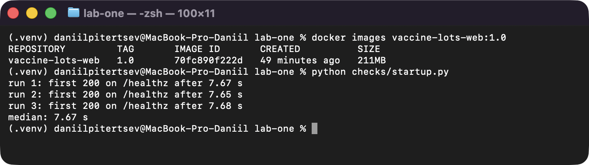

*Рисунок 2 - Розмір образу і три вимірювання часу до першої відповіді 200 на /healthz*

### Етап 5. Навантаження: генератор і серія на одному інстансі

Генератор loadgen/loadgen.py - відкритий контур:
- задана інтенсивність ділиться між процесами за кількістю ядер (до 12 процесів, не менше 25 rps на процес);
- кожен процес наперед обчислює моменти відправки своїх запитів start + (i + k/P) · P/rate і віддає сам запит пулу зі 128 потоків, тож цикл планування не чекає на відповідь; кожен потік тримає власне keep-alive підключення (http.client);
- затримка рахується від запланованого моменту відправки до отримання відповіді, тож затримка всередині самого генератора не ховається; запити, що завершились помилкою підключення або тайм-аутом (10 с), входять у перцентилі з часом до помилки і окремо рахуються за типом помилки;
- ідентифікатор для GET /vaccine-lots/{id} береться випадково з сотні записів, створених через API скриптом loadgen/seed.py;
- прогін - 10 с прогріву (у результат не входять) і 30 с вимірювання; у вимір потрапляють запити, заплановані у вікні вимірювання; досягнута інтенсивність - кількість відповідей 2xx, отриманих у вікні, поділена на 30 с;
- кількість запитів у системі L кожен процес вимірює сам кожні 5 мс як різницю між запланованими на цей момент і завершеними запитами; окремо рахується, скільки з них справді відправлено і чекає відповіді («на проводі»); середні за вікно сумуються по процесах.

Серію 10, 100, 500 запитів за секунду по три повтори запускає loadgen/series.py. Під час кожного прогону він знімає завантаження процесора контейнерів (docker stats) і хоста (top). У таблицю йде медіанний прогін за досягнутою інтенсивністю, з усіма своїми метриками, щоб рядок таблиці описував один реальний прогін; усі три прогони кожного рівня лежать у results/series_*.json (поле runs) і на рис. 4-5.

```sh
python loadgen/seed.py
python loadgen/series.py --label r1
```

Окремий прогін:

```sh
python loadgen/loadgen.py --rate 500 --duration 30 --warmup 10 --ids "$(cat results/ids.txt)" --out run.json --raw run.csv.gz
```

Сирі результати кожного прогону (JSON-підсумок і CSV.GZ з кожним запитом) лежать у results/raw.

Перевірка генератора проти /noop (nginx відповідає сам, сервіс не задіяний):

| Задана, rps | Досягнута, rps | p50, мс | p95, мс | p99, мс | Частка не 2xx |
|---|---|---|---|---|---|
| 10 | 10.0 | 2.95 | 5.15 | 6.48 | 0 |
| 100 | 100.0 | 2.45 | 4.27 | 6.54 | 0 |
| 500 | 499.77 | 1.90 | 2.87 | 4.70 | 0 |
| 2000 | 1999.8 | 1.11 | 1.54 | 3.05 | 0 |
| 4000 | 3999.7 | 0.54 | 0.87 | 1.58 | 0 |
| 6000 | 5999.7 | 0.47 | 1.05 | 1.92 | 0 |

Генератор тримає задану інтенсивність до 6000 rps, тобто на всіх рівнях серії межу задає сервіс, а не генератор. Затримка на малих інтенсивностях вища, ніж на великих; імовірна причина - простій між рідкими запитами (ядра і мережевий стек Docker Desktop встигають заснути), але окремо це не перевірялось.

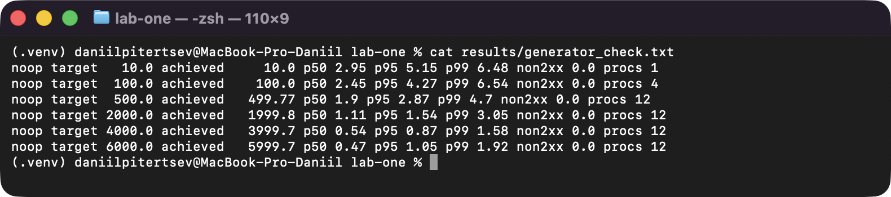

*Рисунок 3 - Перевірка генератора проти ендпоінта /noop: збережені результати прогонів*

Один вебінстанс тримає всі три рівні серії без помилок, тому серію доповнено рівнями 1000-4000 rps, щоб знайти межу пропускної здатності.

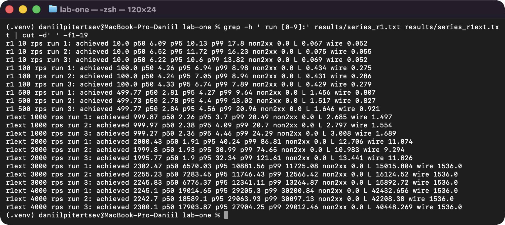

*Рисунок 4 - Серія на одному вебінстансі: 10, 100, 500 rps і додаткові рівні 1000-4000 rps, усі три прогони кожного рівня (журнал series.py)*

### Етап 6. Два вебінстанси і таблиця вимірювань

Стенд перепіднято з двома вебінстансами (docker compose down без -v, дані лишились), серію повторено тією самою командою з --label r2.

```sh
WEB_REPLICAS=2 docker compose up -d
python loadgen/series.py --label r2
```

Основна таблиця - шість конфігурацій, медіанний прогін із трьох:

| Інстансів | Задана, rps | Досягнута, rps | p50, мс | p95, мс | p99, мс | Частка не 2xx |
|---|---|---|---|---|---|---|
| 1 | 10 | 10.0 | 6.52 | 11.72 | 16.23 | 0 |
| 1 | 100 | 100.0 | 4.24 | 7.05 | 8.94 | 0 |
| 1 | 500 | 499.77 | 2.81 | 4.27 | 9.64 | 0 |
| 2 | 10 | 10.0 | 5.92 | 11.01 | 12.00 | 0 |
| 2 | 100 | 100.0 | 4.43 | 6.67 | 7.65 | 0 |
| 2 | 500 | 499.77 | 2.84 | 4.28 | 6.89 | 0 |

Додаткові рівні (медіанний прогін із трьох; CPU - середнє docker stats за вікно вимірювання, ліміт web - 100%):

| Інстансів | Задана, rps | Досягнута, rps | p50, мс | p95, мс | p99, мс | Частка не 2xx | L у системі | на проводі | CPU web, % |
|---|---|---|---|---|---|---|---|---|---|
| 1 | 1000 | 999.87 | 2.26 | 3.70 | 20.49 | 0 | 2.7 | 1.5 | 42.5 |
| 1 | 2000 | 1999.80 | 1.93 | 30.99 | 74.65 | 0 | 11.0 | 9.3 | 68.5 |
| 1 | 3000 | 2255.23 | 7283.45 | 11746.43 | 12566.42 | 0 | 16125 | 1536 | 101.2 |
| 1 | 4000 | 2245.10 | 19014.65 | 29205.30 | 30200.84 | 0 | 42433 | 1536 | 100.6 |
| 2 | 1000 | 999.93 | 2.23 | 3.56 | 10.12 | 0 | 2.5 | 1.3 | 29.0 / 28.7 |
| 2 | 2000 | 1999.83 | 1.71 | 3.19 | 23.72 | 0 | 4.5 | 3.0 | 43.8 / 43.7 |
| 2 | 3000 | 2999.73 | 1.62 | 21.09 | 63.23 | 0 | 12.3 | 10.6 | 58.1 / 60.1 |
| 2 | 4000 | 3791.00 | 357.53 | 2413.28 | 3866.11 | 0.00002 (2 тайм-аути) | 2462 | 950 | 73.7 / 90.9 |
| 2 | 5000 | 3548.83 | 9877.13 | 14637.43 | 15937.93 | 0.00003 (4 тайм-аути) | 36022 | 1536 | 84.5 / 104.7 |

На рівнях 10-500 rps обидві конфігурації тримають задану інтенсивність, затримки однакові в межах шуму: web завантажений на 10-34% ядра, і другий інстанс нічого не дає. Затримку на цих рівнях визначає шлях запиту (генератор - мережа Docker Desktop - nginx - сервіс - PostgreSQL), а не черга.

Рівень, на якому один інстанс перестав тримати задану інтенсивність, - 3000 rps. Це видно за чотирма числами: досягнута інтенсивність зупинилась на 2255 rps замість 3000 (на 4000 rps - 2245, тобто вище не росте), p50 стрибнув з 1.9 мс до 7.3 с, L - з 11 до 16125, а web використовує 101% свого ліміту в 1 CPU. Перші ознаки вже на 2000 rps: досягнута ще дорівнює заданій, але p95 виріс з 3.7 до 31 мс, CPU web - 68%. Межа одного інстансу - близько 2250 rps, її задає ліміт в 1 CPU: процес uvicorn один і впирається в своє ядро. Помилок не було - запити не відкидались, а стояли в черзі; черга при цьому лежить у генераторі, а не в nginx чи сервісі: на проводі одночасно не більше 1536 запитів (12 процесів по 128 потоків), решта з 16125 - заплановані запити, які ще чекають вільного потоку генератора.

Два інстанси тримають 3000 rps (досягнуто 2999.73, p50 1.62 мс), на 4000 rps вже насичуються (3791 rps, p50 358 мс, web-2 на 91%), на 5000 rps досягнута - 3549 rps, p50 9.9 с, один із web на 105% ліміту. Межа двох інстансів - близько 3550-3800 rps, тобто не вдвічі вища за 2250, а в 1.6-1.7 раза.

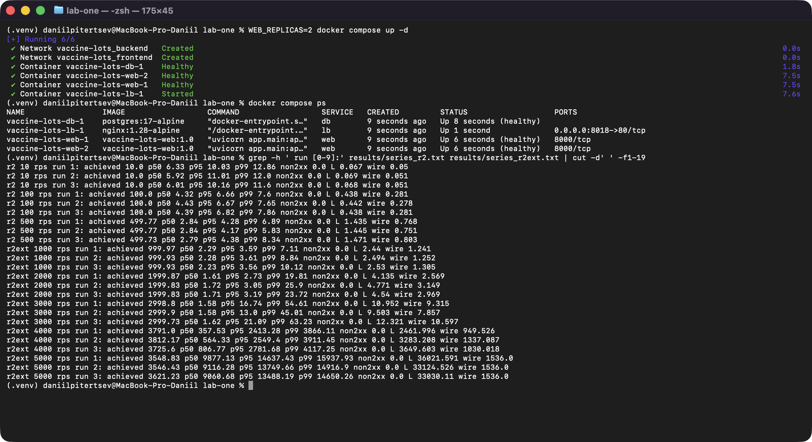

*Рисунок 5 - Стенд із двома вебінстансами і серія 10-5000 rps, усі три прогони кожного рівня (журнал series.py)*

Розподіл запитів підтверджено двома незалежними способами. Журнал nginx за час серії r2 (рівні 10, 100, 500 rps, по три прогони разом із прогрівом): по 36588 запитів на кожну з двох адрес 172.28.0.2:8000 і 172.28.0.3:8000, рівно навпіл (round robin); docker inspect показує, що це адреси контейнерів vaccine-lots-web-2 і vaccine-lots-web-1. Лічильник на боці генератора за заголовком X-Instance дає те саме: у медіанному прогоні на 500 rps по 7496 відповідей від кожного з двох контейнерів.

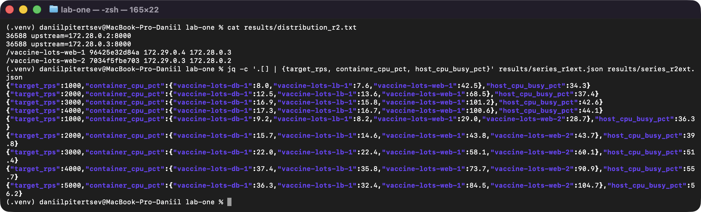

*Рисунок 6 - Розподіл запитів за журналом nginx під час серії r2 і завантаження процесора контейнерів і хоста на рівнях 1000-5000 rps (збережені результати)*

### Етап 7. Розрахунки

#### Прискорення і метрика Карпа-Флатта

S = X₂ / X₁ (досягнута інтенсивність двох інстансів до досягнутої одного на тому самому рівні), e = (1/S - 1/N) / (1 - 1/N), для N = 2: e = (1/S - 0.5) / 0.5. Медіанні прогони, діапазон - за всіма трьома прогонами кожної конфігурації:

| Рівень, rps | X₁ | X₂ | S | e | S за трьома прогонами | e за трьома прогонами |
|---|---|---|---|---|---|---|
| 10 | 10.0 | 10.0 | 1.000 | 1.00 | 1.000 | 1.00 |
| 100 | 100.0 | 100.0 | 1.000 | 1.00 | 1.000 | 1.00 |
| 500 | 499.77 | 499.77 | 1.000 | 1.00 | 1.000 | 1.00 |
| 1000 | 999.87 | 999.93 | 1.000 | 1.00 | 1.000-1.001 | 1.00 |
| 2000 | 1999.80 | 1999.83 | 1.000 | 1.00 | 1.000-1.002 | 1.00 |
| 3000 | 2255.23 | 2999.73 | 1.330 | 0.50 | 1.30-1.34 | 0.50-0.54 |
| 4000 | 2245.10 | 3791.00 | 1.689 | 0.18 | 1.62-1.70 | 0.18-0.24 |

На рівнях 10-2000 rps S = 1 і e = 1 - це артефакт недовантаження, а не відсутність паралельності: обидві конфігурації віддають рівно задану інтенсивність, і виміряти, скільки міг би дати другий інстанс, неможливо. На 3000 rps два інстанси ще не насичені, і S обмежене заданою інтенсивністю. Показовий рівень - 4000 rps, де насичені обидві конфігурації:

S = 3791.00 / 2245.10 = 1.689

e = (1/1.689 - 0.5) / 0.5 = (0.592 - 0.5) / 0.5 = 0.18

З урахуванням розкиду прогонів S = 1.62-1.70, e = 0.18-0.24: близько п'ятої частини роботи не отримала виграшу від другого інстансу.

Спільними для обох інстансів лишились один балансувальник nginx, одна база PostgreSQL і одна фізична машина, на якій працюють генератор (12 процесів Python), віртуальна машина Docker і сторонні застосунки. Що з цього стало стелею, видно з завантаження (рис. 6):
- на 5000 rps web-2 використовує 105% свого ліміту, а nginx (32%) і база (36%) далекі від насичення; при рівному round robin пару обмежує інстанс, який першим упирається в свій 1 CPU;
- при цьому кожен з двох інстансів у парі обслуговує близько 1775-1900 rps, менше за 2250 одного інстансу. Імовірна причина - спільний процесор хоста: від 3000 rps він зайнятий на 51-56% (генератор, віртуальна машина Docker, nginx, база, сторонні процеси), і другий web отримує менше реального процесорного часу, ніж давав би ліміт. Це припущення: ізольовано, без генератора на тій самій машині, його не перевіряли.

#### Перевірка закону Літтла

L = λ · W, рівень 100 rps, один інстанс, усі три прогони (λ - задана і досягнута інтенсивність, 100 запитів/с; W - середній час відповіді):

| Прогін | W, мс | λ · W | Виміряне L | Розбіжність |
|---|---|---|---|---|
| 1 | 4.47 | 100 · 0.00447 = 0.447 | 0.434 | 3.0% |
| 2 (медіанний) | 4.43 | 100 · 0.00443 = 0.443 | 0.431 | 2.8% |
| 3 | 4.41 | 100 · 0.00441 = 0.441 | 0.429 | 2.8% |

Закон виконується з розбіжністю близько 3%, і вона систематична: виміряне L завжди трохи менше. Імовірна причина - сам замір: L знімає окремий потік кожні 5 мс, і йому теж потрібен GIL інтерпретатора, тож моменти зняття не зовсім випадкові відносно моментів відправки і завершення запитів.

#### Порівняння з закритим контуром

Рівень, де один інстанс уже не тримає задану інтенсивність, - 3000 rps. Відкритий контур на ньому (медіанний прогін): досягнута 2255.23 rps, p95 11746.43 мс, у системі в середньому 16125 запитів, з них на проводі - 1536: стільки запитів сервер справді бачив одночасно, решта чекала в черзі генератора. Тому закритий прогін виконано з конкурентністю 1536, рівною виміряній кількості одночасних запитів на проводі (кожен потік відправляє наступний запит лише після відповіді на попередній):

| Контур | Одночасних запитів | Досягнута, rps | p50, мс | p95, мс |
|---|---|---|---|---|
| відкритий, 3000 rps | 16125 у системі, з них 1536 на проводі | 2255.23 | 7283.45 | 11746.43 |
| закритий | 1536 | 2270.27 | 632.78 | 1988.67 |

Пропускна здатність майже однакова - це межа сервісу, вона не залежить від способу подачі навантаження. А p95 у закритому контурі в 5.9 раза менший. Причина: закритий контур сам пригальмовує, коли сервіс сповільнюється - новий запит не відправляється, поки не прийшла відповідь, тому черга ніколи не перевищує 1536, і середня затримка обмежена L / X = 1536 / 2270 = 0.68 с (виміряно 0.67 с). У відкритому контурі запити надходять за графіком незалежно від відповідей, надлишок 3000 - 2255 = 745 запитів щосекунди накопичується, черга і затримка ростуть увесь прогін, і p95 відображає саме цей ріст. Тому p95 відкритого контуру під перевантаженням залежить від тривалості прогону, і порівняння «в 5.9 раза» коректне саме для однакових 30-секундних вікон. Закритий контур приховує перевантаження: він показує сервіс, який повільнішає, але встигає, а реальні клієнти, які приходять незалежно один від одного, бачили б секунди очікування.

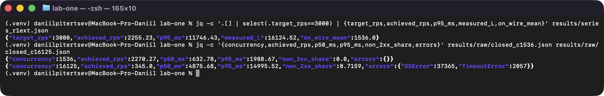

*Рисунок 7 - Відкритий і закритий контур на рівні 3000 rps: підсумки прогонів із results*

Буквальна спроба закритого прогону з 16125 одночасними підключеннями теж записана: 345 rps, 72% запитів завершились помилкою (37365 OSError і 2057 TimeoutError). Причину перевірено окремо скриптом checks/port_probe.py: на macOS діапазон портів для вихідних підключень - 49152-65535, тобто 16384 порти, і спроба відкрити 17000 підключень до стенду впирається в помилку EADDRNOTAVAIL (errno 49, «Can't assign requested address»). 16125 одночасних підключень разом із закритими, які ще висять у TIME_WAIT, вичерпують цей діапазон; межу задає клієнтська машина, а не сервіс (рис. 8).

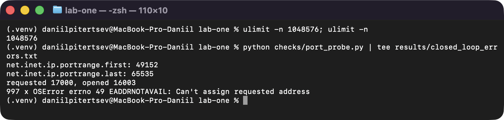

*Рисунок 8 - Проба 17000 одночасних підключень: діапазон портів і помилка EADDRNOTAVAIL*

### Етап 8. Додаткова вимога варіанта: база у внутрішній мережі

Стенд має дві мережі. frontend - звичайна мережа bridge, у ній lb і web. backend оголошена з internal: true, у ній db і web. Docker не створює для внутрішньої мережі ні маршруту назовні, ні пробросу портів, а в сервісу db немає секції ports. Тому з хоста до бази підключитись не можна, з контейнера сервісу - можна за іменем db. Перевірка - скрипт checks/db_isolation.sh (рис. 9). Доказову силу мають перші три пункти: порт не опубліковано, мережа внутрішня, на 127.0.0.1:5432 ніхто не слухає. Тайм-аут до IP контейнера бази з хоста нічого окремо не доводить, бо на macOS IP контейнерів з хоста не маршрутизуються за будь-якої мережі; він наведений лише для повноти.
- docker compose port db 5432 - порт не опубліковано;
- docker network inspect - internal=true;
- з хоста підключення до 127.0.0.1:5432 - Connection refused;
- з хоста до IP контейнера бази - тайм-аут;
- з контейнера web asyncpg підключається до db:5432, SELECT version() повертає PostgreSQL 17.11, у таблиці 100 партій;
- з контейнера db немає виходу назовні (wget example.com - bad address).

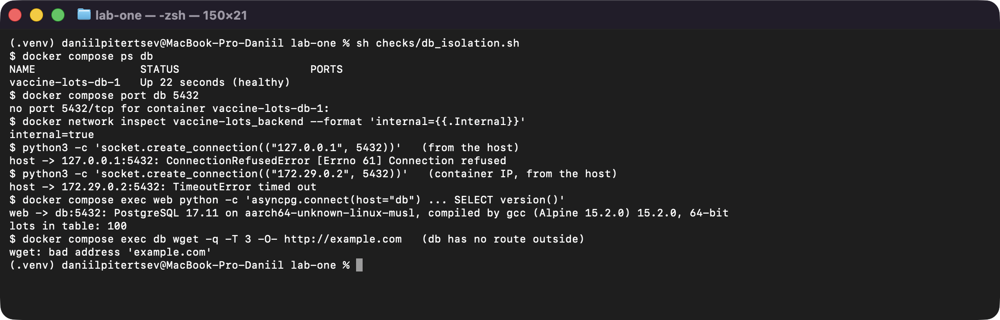

*Рисунок 9 - Перевірка: з хоста до бази підключення немає, з контейнера сервісу є*

### Етап 9. Перевірка: журнал запитів

Скрипт checks/verify.py проходить повний цикл через балансувальник (рис. 10):

| Запит | Що повернув сервіс |
|---|---|
| POST /vaccine-lots (партія LOT-2609-V018) | 201, запис з id 101 |
| GET /vaccine-lots?vaccine=Vaxigrip%20Tetra&limit=100 | 200, total 14, id 101 є в переліку |
| GET /vaccine-lots/101 | 200, той самий запис |
| PUT /vaccine-lots/101 (doses 480, expires_on 2027-03-31) | 200, оновлений запис |
| POST з doses 0 і expires_on раніше за manufactured_on | 400, два пояснення: doses і expires_on |
| PUT /vaccine-lots/101 лише з lot_number | 400, пʼять полів «Field required» |
| POST з наявним lot_number | 409, lot_number already exists |
| DELETE /vaccine-lots/101 | 204, порожнє тіло |
| GET /vaccine-lots/101 | 404 |
| PUT /vaccine-lots/101 | 404 |
| DELETE /vaccine-lots/101 (повторно) | 404 |

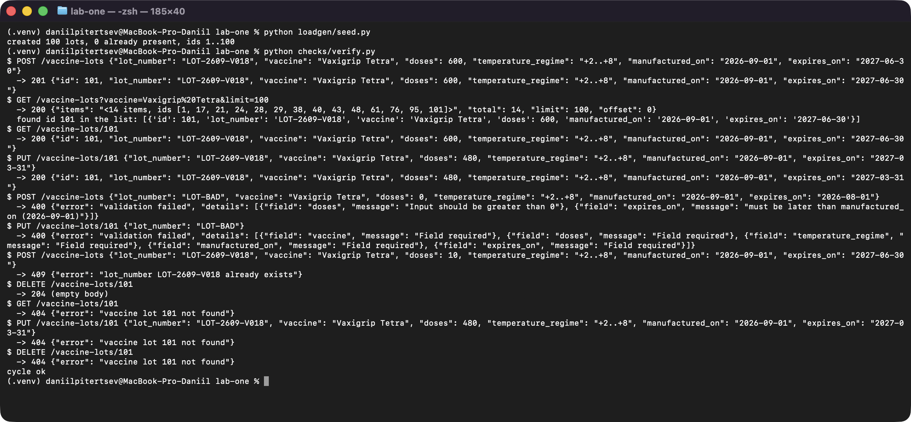

*Рисунок 10 - Журнал перевірки повного циклу*

Після docker compose down і повторного up записи на місці (total 100, партія 42 та сама, рис. 11). Після docker compose down -v том видаляється, стенд піднімається без помилок, /healthz дає 200, перелік порожній (total 0), GET /vaccine-lots/42 - 404 (рис. 12).

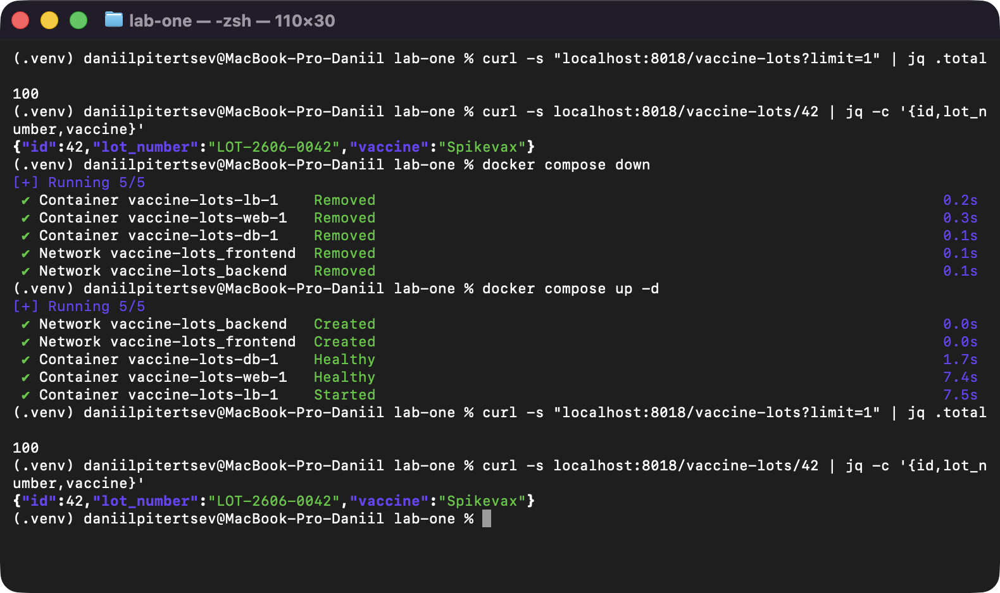

*Рисунок 11 - Збереження даних після docker compose down і повторного up*

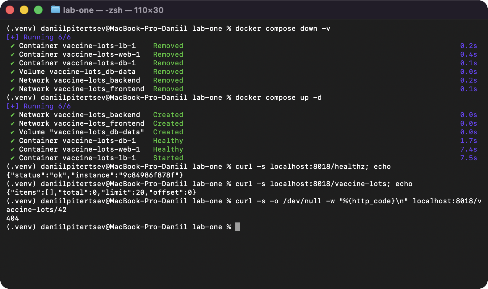

*Рисунок 12 - Порожня база і робочий стенд після docker compose down -v*

## Відкинуті рішення

1. Готовий інструмент навантаження з віртуальними користувачами (locust, wrk, ab). Відкинуто: це закритий контур, він сам пригальмовує при перевантаженні і ховає затримку (див. етап 7); до того ж завдання вимагає власного генератора.
2. ORM (SQLAlchemy) замість прямих запитів asyncpg у репозиторії. Відкинуто: запитів шість і всі прості, ORM додала б залежність і накладні витрати саме на вимірюваному шляху.
3. Кілька процесів uvicorn (--workers) в одному контейнері. Відкинуто: при ліміті 1 CPU другий процес лише ділить те саме ядро, а масштабування за умовою роблять репліками за балансувальником.
4. Копіювання блоку web1/web2 у docker-compose.yml. Відкинуто: завдання вимагає одного параметра запуску; replicas: ${WEB_REPLICAS} дає це без правок у файлах.
5. Upstream у nginx без resolve. Відкинуто: nginx визначив би адреси один раз при старті і не побачив би репліку, додану пізніше.
6. Healthcheck через curl. Відкинуто: у python:3.12-slim curl немає, а ставити його лише заради перевірки - це зайвий пакет в образі; python з urllib уже є.
7. Стандартний keep-alive uvicorn (5 с). Відкинуто після вимірювань: в одному з прогонів попередньої версії стенду nginx кілька секунд віддавав 502 «no live upstreams» - uvicorn закривав простоююче підключення саме тоді, коли nginx відправляв у нього запит, nginx отримував reset і тимчасово помічав інстанси як недоступні. Сирі результати того прогону не збережено, бо після виправлення (keep-alive 75 с у uvicorn і 30 с у nginx) серію знято заново повністю.
8. Синхронна залежність FastAPI для створення сервісу (def lot_service). Відкинуто після вимірювань: FastAPI виконує синхронні залежності в пулі потоків, і після розкладання коду на шари один інстанс на 2000 rps тримав лише близько 1800 rps з p50 близько 1 с. Та сама залежність, оголошена як async def, повернула 2000 rps з p50 1.5 мс.

## Висновки

Сервіс для партій вакцин на складі (/vaccine-lots, варіант 18) реалізовано на FastAPI і PostgreSQL з розкладанням на DTO, репозиторій, сервіс і роутер: шість ендпоінтів, валідація з поясненням (термін придатності пізніший за дату виготовлення, кількість доз більша за нуль), 409 на дублікат номера партії, повторний DELETE дає 404, граничні значення дають 400, а не 500, /healthz перевіряє саме базу. Образ двоетапний на python:3.12-slim, 211.4 МБ, стенд з бази, сервісу і nginx піднімається однією командою, від up до першої відповіді 200 - 7.67 с (медіана). База лежить у внутрішній мережі: з хоста підключення немає, з контейнера сервісу є.

На рівнях 10, 100 і 500 rps і один, і два інстанси тримають задану інтенсивність без помилок, p95 не більше 12 мс; другий інстанс тут нічого не змінює. Один інстанс перестав тримати задану інтенсивність на 3000 rps: досягнута зупинилась на 2255 rps, p50 виріс з 1.9 мс до 7.3 с, web упирається в свій ліміт 1 CPU. Два інстанси тримають 3000 rps з p50 1.6 мс і насичуються на 3550-3800 rps. Прискорення на 4000 rps S = 1.69 (1.62-1.70), метрика Карпа-Флатта e = 0.18 (0.18-0.24); при рівному round robin пару обмежує інстанс, що першим упирається в CPU, а спільна машина з генератором, імовірно, забирає частину процесорного часу. Закон Літтла виконується з розбіжністю близько 3%. Закритий контур із 1536 одночасними запитами на тому самому сервісі дав ту саму пропускну здатність (2270 rps), але p95 у 5.9 раза менший (1989 мс проти 11746 мс), бо він сам обмежує чергу і приховує перевантаження.

## Відповіді на контрольні питання

**1. Чому PUT у цій роботі замінює запис повністю і чим би відрізнявся PATCH.**

PUT за семантикою HTTP передає повне нове представлення ресурсу: сервер замінює запис цілком, тому тіло PUT валідується тим самим DTO, що й POST, і запит без будь-якого обовʼязкового поля дає 400. Повторний однаковий PUT дає той самий стан - операція ідемпотентна. PATCH передавав би лише змінювані поля і змінював тільки їх; тоді валідацію правила «термін придатності пізніший за дату виготовлення» довелося б робити над злиттям нових полів зі збереженими, а операція в загальному випадку не ідемпотентна.

**2. Який код відповіді має повернути створення запису з ідентифікатором, який уже існує, і чому.**

409 Conflict: запит синтаксично правильний, але суперечить поточному стану ресурсу. У цій роботі id генерує база і клієнт його не передає (зайве поле id відхиляється з 400), а природний унікальний ключ - номер партії, і його дублікат сервіс повертає як 409 з поясненням. 400 тут неправильний, бо дані валідні, а 500 - тим більше, бо це не збій сервера.

**3. Що зберігається в шарі образу і чому порядок інструкцій у Dockerfile впливає на час перезбірки.**

Кожна інструкція, що змінює файлову систему (RUN, COPY, ADD), створює шар - знімок доданих, змінених і видалених файлів. Шари кешуються: Docker перевикористовує шар, якщо інструкція і всі шари перед нею не змінились. Зміна одного шару інвалідовує кеш усіх наступних. Тому рідко змінювані речі ставлять раніше: тут спершу копіюється requirements.txt і ставляться залежності, а пакет app/ копіюється останнім - правка коду перезбирає лише останній шар у 12.8 кБ, а не перевстановлює пакети.

**4. Що станеться з даними бази після docker compose down, після docker compose down -v і після видалення контейнера бази вручну.**

down видаляє контейнери і мережі, але не іменовані томи - дані в томі db-data лишаються, і після up записи на місці (перевірено: total 100). down -v видаляє ще й томи - дані втрачено, при наступному up PostgreSQL ініціалізує порожню базу і заново накочує схему (перевірено: total 0). Ручне видалення контейнера (docker rm) не чіпає іменований том, тож дані зберігаються і підхоплюються новим контейнером; втратились би лише дані в анонімному томі або в шарі самого контейнера.

**5. Чому depends_on без умови за станом не гарантує, що база готова приймати підключення.**

Без умови depends_on чекає лише запуску контейнера, тобто старту процесу. PostgreSQL після старту ще ініціалізує каталог даних, виконує скрипти з docker-entrypoint-initdb.d і перезапускається - кілька секунд підключення відхиляються. Тому тут використано condition: service_healthy. Але й сам healthcheck треба писати уважно: pg_isready через unix-сокет може пройти ще на тимчасовому сервері init-фази, тож тут перевірка йде через TCP (-h 127.0.0.1), а сервіс додатково повторює спробу створити пул, поки база не відповість.

**6. Чим відрізняється EXPOSE від публікації порту і як сервіс дістається бази без публікації її порту на хост.**

EXPOSE (і expose у Compose) лише документує, на якому порту слухає контейнер; він нічого не відкриває назовні. Публікація (ports) створює проброс із порту хоста в контейнер. Контейнери в одній мережі Compose бачать один одного напряму за IP, а вбудований DNS Docker перетворює імʼя сервісу db на його адресу. Тому web підключається до db:5432 всередині мережі backend, і публікація не потрібна (див. етап 8).

**7. Чим відрізняється генератор із фіксованою швидкістю надходження від генератора з фіксованою кількістю віртуальних користувачів і чому другий приховує затримку під перевантаженням.**

Генератор з фіксованою швидкістю надходження (відкритий контур) відправляє запити за наперед обчисленим графіком, незалежно від відповідей - як незалежні реальні клієнти. Генератор з віртуальними користувачами (закритий контур) відправляє наступний запит лише після відповіді на попередній, тож коли сервіс сповільнюється, сповільнюється і подача запитів. Черга не може перевищити кількість користувачів, і затримка лишається обмеженою, хоча реальні клієнти чекали б дедалі довше. Це видно на етапі 7: та сама пропускна здатність, але p95 1989 мс у закритому контурі проти 11746 мс у відкритому.

**8. Що змінилось у вашій серії після додавання другого вебінстансу і яка складова стенду лишилась спільною для обох.**

На рівнях 10-500 rps нічого: обидві конфігурації тримають задану інтенсивність з однаковими затримками. Зміни видно вище: на 3000 rps один інстанс насичений (2255 rps, p50 7.3 с), а два тримають 3000 rps з p50 1.6 мс; межа зросла з ~2250 до ~3550-3800 rps, тобто в 1.6-1.7 раза, а не вдвічі. Спільними лишились один балансувальник nginx, одна база PostgreSQL і одна машина з генератором, віртуальною машиною Docker і сторонніми процесами.

**9. Що означає отримане вами значення метрики Карпа-Флатта і як воно змінилось би, якби база була не одна на два інстанси.**

e = 0.18 (0.18-0.24 з урахуванням розкиду) означає, що близько пʼятої частини роботи на запит не паралелиться між інстансами. За виміряним завантаженням база на 4000-5000 rps зайнята лише на 36-37%, тож вона зараз не вузьке місце, і окрема база (наприклад, репліка для читання, бо вимірюється лише GET) майже не змінила б e на цьому стенді. Помітно e зменшилось би, якби прибрати інші спільні складові: винести генератор на окрему машину і дати кожному інстансу гарантований процесорний час. Якби ж навантаження було важчим для бази (складні запити, запис), саме спільна база стала б головною частиною e, і окрема база на інстанс наблизила б S до 2.

**10. Чому час відповіді зростає швидше за інтенсивність, коли сервіс наближається до межі пропускної здатності.**

Час відповіді - це час обслуговування плюс очікування в черзі. Для системи з одним обслуговувачем середнє очікування пропорційне ρ / (1 - ρ), де ρ - завантаження: при ρ = 0.5 множник 1, при 0.9 - 9, при 0.99 - 99, а при ρ ≥ 1 черга росте без обмеження. Тому біля межі мале зростання інтенсивності дає непропорційно велике зростання затримки. У серії одного інстансу: на 2000 rps (ρ близько 0.9 від межі 2250) p95 вже 31 мс проти 3.7 мс на 1000 rps, а на 3000 rps (ρ > 1) p50 - 7.3 с і росте впродовж прогону.
