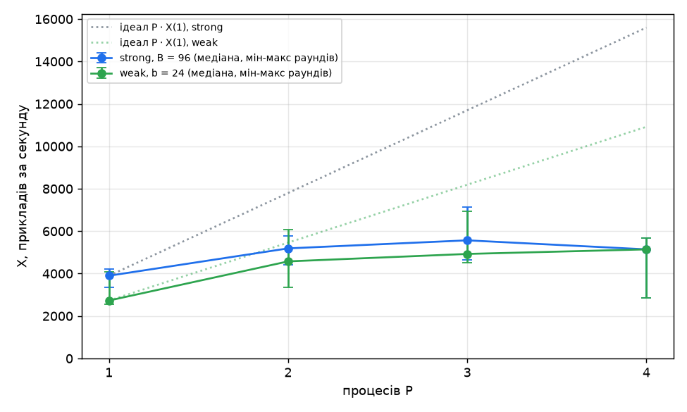

# Лабораторна робота №6. Розподілене навчання нейромережі за даними на CPU

Варіант 18.
* Датасет: Д6, OCTMNIST (оптична когерентна томографія сітківки), K = 4 класи, C = 1 канал.
* Ширина мережі: Ш2, c1 / c2 / h = 32 / 64 / 256.
* Найбільша кількість процесів P_max = 4, глобальний батч B = 96, батч процесу на P_max процесах b = 24.
* Контрольна точка кожні K_c = 10 кроків, відмова на кроці s_f = 25.

## Структура проєкту
* `common.py` - параметри варіанта, `load_split`, `Net`, `n_params_formula` з умови без змін.
* `train.py` - навчання в одному процесі (`--mode single`) або на P процесах через torchrun з ручною синхронізацією (`manual`), DDP (`ddp`) чи DDP з `no_sync` (`ddp_nosync`); задачі `train` (n_ep епох, втрата кожного кроку, ACC, AUC, контрольні точки, імітація відмови), `speed` (10 кроків прогріву і 50 вимірюваних), `equiv` (перевірка еквівалентності градієнта і сум ваг).
* `experiments.py` - усі прогони кроків 1-5, `analyze.py` - таблиці (`results/tables.md`, `results/analysis.json`) і діаграми (`docs/charts`).
* `results/` - JSON і журнали кожного прогону, журнали втрат `*.loss.jsonl`, вимірювання швидкості `results/speed/`, `results/rejected/` - відкинуті прогони.

Цикл навчання написано самостійно: `DataLoader` з `DistributedSampler(seed=0)` і `drop_last=True`, `sampler.set_epoch(epoch)` перед кожною епохою, SGD з моментом 0.9, `CrossEntropyLoss` (середнє за прикладами). Модель створюється після `torch.manual_seed(0)`, `n_params` перевіряється формулою з умови.

## Хід роботи

### Крок 1. Стенд і навчання в одному процесі

Таблиця 1. Стенд

| Процесор | Фізичних ядер C_phys | Логічних ядер | Памʼять, ГБ | ОС | Python | PyTorch | n_th |
|---|---|---|---|---|---|---|---|
| Apple M3 Pro (6 продуктивних + 6 енергоефективних) | 12 | 12 | 38.7 | macOS 26.4.1 | 3.14.3 | 2.15.0 (CPU, gloo) | ⌊12 / 4⌋ = 3 |

| Датасет | K | C | c1 / c2 / h | n_params | M, МіБ | N | B | P_max |
|---|---|---|---|---|---|---|---|---|
| Д6 OCTMNIST | 4 | 1 | 32 / 64 / 256 | 822 916 | 3.14 (3 291 664 Б) | 7000 | 96 | 4 |

n_params = 9 · 1 · 32 + 32 + 9 · 32 · 64 + 64 + 49 · 64 · 256 + 256 + 256 · 4 + 4 = 822 916, з них 802 816 (97.6 %) - вага першого повнозвʼязного шару. M = 4 · n_params = 3 291 664 Б = 3.14 МіБ.

`torch.set_num_threads(3)` викликається на початку кожного прогону, включно з однопроцесними; на 4 процесах P · n_th = 12 = C_phys. Половина ядер M3 Pro енергоефективні, тому при 12 потоках частина процесів отримує повільніші ядра, а синхронний крок чекає найповільнішого.

Дані: перші 7000 прикладів `train` і весь `test` (1000 прикладів, по 250 кожного класу) файлу `octmnist.npz` з Zenodo. Навчальна частина незбалансована: класи 0, 1, 2, 3 займають 34 %, 10 %, 7 % і 48 %.

Навчання в одному процесі без `torch.distributed`, B = 96, η₀ = 0.02, 3 епохи по 72 кроки: ACC = 0.357, AUC = 0.7008. Швидкість - перший рядок таблиці 2.

**Методика вимірів швидкості.** Кожен прогін: 10 кроків прогріву, `dist.barrier()`, 50 вимірюваних кроків. t_step - медіана часу 50 кроків процесу 0 (від початку forward до кінця кроку оптимізатора, батчі заздалегідь узяті з `DataLoader`), X = 50 · B / t, де t - тривалість 50 кроків процесу 0. Машина під час вимірів не була вільною (браузер, IDE, Docker Desktop з контейнерами інших проєктів, процес Spotify ~1.2 ядра; load average 5-10), і один прогін давав розкид до ±30 %. Тому кожну конфігурацію виміряно 5 разів, причому в кожному раунді всі 13 конфігурацій ідуть одна за одною, щоб повільні зміни фонового навантаження потрапляли на всі однаково; у таблицях - медіана за раундами, розкид наведено в `results/tables.md`. t_comm,exp = t_step − t_step,ns обчислено в межах кожного раунду (прогони DDP і `no_sync` ідуть поспіль) і взято медіану.

### Крок 2. P_max процесів: ручна синхронізація і DDP

Запуск: `torchrun --nnodes=1 --nproc_per_node=4 --rdzv-backend=static --master-addr=127.0.0.1 ...`, група gloo через loopback (`GLOO_SOCKET_IFNAME=lo0`). Ручна синхронізація: `dist.broadcast(p.data, src=0)` для кожного параметра перед першим кроком, після `backward()` - `dist.all_reduce(p.grad)` і ділення на P для кожного з 8 тензорів.

**Еквівалентність.** Перший батч навчальної частини, 96 прикладів у природному порядку. Градієнт g обчислено в одному процесі на всіх 96 прикладах з тими самими вагами, ḡ - на 4 процесах, де процес r бере приклади r, r + 4, ... і градієнти усереднюються ручною синхронізацією. Найбільше відношення max |g − ḡ| / max |g| за 8 тензорами - **2.26 · 10⁻⁶** (у вазі другої згортки; для решти тензорів 1 · 10⁻⁷ - 3 · 10⁻⁷), у межах 10⁻⁶-10⁻⁵ від різного порядку додавання у float32. Після 50 кроків суми всіх ваг у float64, зібрані `all_gather`, у всіх 4 процесах однакові: різниця **0.0** і для ручної синхронізації, і для DDP.

**DDP** з типовим `bucket_cap_mb = 25`: усі 8 тензорів (3 291 664 Б) потрапили в один кошик, бо найбільший тензор - вага першого повнозвʼязного шару - сам займає 3.2 МБ, а саме з нього (у зворотному порядку шарів) і починається кошик. Отже all-reduce запускається один раз, коли готові градієнти всіх параметрів, і перекриватися йому майже нема з чим.

Таблиця 2. Синхронізація градієнтів

| Режим | t_step, мс | Час обміну на крок, мс | Частка кроку в обміні | X, прикл./с |
|---|---|---|---|---|
| 1 процес, батч B | 21.59 | 0 | 0 | 4 111 |
| 4 процеси, ручна синхронізація | 25.58 | 9.06 (t_sync) | 0.354 | 3 552 |
| 4 процеси, DDP | 17.52 | 4.64 (t_comm,exp) | 0.265 | 5 142 |
| 4 процеси, DDP, no_sync | 13.58 | 0 | 0 | 6 647 |

| max \|g − ḡ\| / max \|g\| | Різниця сум ваг між процесами після 50 кроків | ACC, 1 процес | ACC, DDP на 4 | AUC, 1 процес | AUC, DDP на 4 |
|---|---|---|---|---|---|
| 2.26 · 10⁻⁶ | 0.0 | 0.357 | 0.352 | 0.7008 | 0.6997 |

Ручна синхронізація повільніша за один процес: 8 послідовних all-reduce після backward коштують 9.1 мс, більше, ніж економить поділ батча. неперекрита частина обміну DDP удвічі менша (4.6 мс): DDP робить один all-reduce на весь 3.1-МіБ кошик замість восьми окремих викликів, і отримує 5 142 прикладів за секунду, у 1.25 раза більше за один процес. Без обміну (no_sync) було б 6 647. ACC і AUC після 3 епох в одному процесі і на 4 процесах майже однакові; відмінність у третьому знаці - накопичення різниці порядку 10⁻⁶ у градієнтах за 216 кроків.

### Крок 3. Strong scaling

Таблиця 3. Strong scaling, B = 96 (DDP, також P = 1 через torchrun)

| P | b | t_step, мс | t_step,ns, мс | X, прикл./с | S | E | e | c |
|---|---|---|---|---|---|---|---|---|
| 1 | 96 | 23.38 | 22.34 | 3 900 | 1 | 1 | − | 0.018 |
| 2 | 48 | 17.34 | 15.51 | 5 189 | 1.331 | 0.665 | 0.503 | 0.126 |
| 3 | 32 | 16.20 | 14.18 | 5 568 | 1.428 | 0.476 | 0.551 | 0.101 |
| 4 | 24 | 17.52 | 13.58 | 5 142 | 1.319 | 0.330 | 0.678 | 0.265 |

*Рисунок 1 - X(P) для strong (B = 96) і weak (b = 24) scaling: медіана і мінімум-максимум за 5 раундами, пунктир - ідеальна пряма P · X(1)*

Прискорення не перевищує 1.43 і найбільше на 3 процесах; на 4 процесах X знову менша. Метрика Карпа-Флатта зростає з 0.50 до 0.68, тобто частка роботи, що не розпаралелилась, збільшується з P - її визначають обмін і синхронізація, а не стала послідовна частина. Внесок обміну видно в c: на 4 процесах 26 % кроку - неперекритий all-reduce. Проте й без обміну (t_step,ns) 4 процеси роблять крок лише в 1.6 раза швидше за один, хоча кожен обробляє вчетверо менше прикладів: згортки і множення матриць на батчі 24 використовують потоки гірше, ніж на батчі 96 (один процес на батчі 24 обробляє 2 730 прикладів за секунду проти 3 900 на батчі 96, таблиця 4), а 12 потоків ймовірно займають і енергоефективні ядра, і ядра, на яких працює фонове навантаження. На GPU, де обчислення в десятки разів швидші, частка обміну була б ще більшою.

Розкид між раундами великий (наприклад, X(4) від 2 858 до 5 690), тому різниця між P = 2, 3 і 4 у межах ±10 % не є надійною; надійний висновок - насичення X на рівні близько 5 000-5 600 прикладів за секунду вже з 2 процесів.

### Крок 4. Weak scaling і правило масштабування швидкості навчання

Таблиця 4. Weak scaling, b = 24

| P | B_P | t_step, мс | X, прикл./с | S_w | E_w |
|---|---|---|---|---|---|
| 1 | 24 | 7.64 | 2 730 | 1 | 1 |
| 2 | 48 | 9.95 | 4 575 | 1.676 | 0.838 |
| 3 | 72 | 14.50 | 4 927 | 1.805 | 0.602 |
| 4 | 96 | 17.52 | 5 142 | 1.883 | 0.471 |

Рядок P = 4 узято з таблиці 3. З однаковим батчем на процес t_step росте з 7.6 до 17.5 мс: до кроку додаються all-reduce (той самий 3.1-МіБ буфер незалежно від b) і конкуренція 12 потоків за ядра. X(1) на батчі 24 значно менша, ніж на батчі 96 (2 730 проти 3 900), тому weak scaling виглядає кращим за strong лише відносно слабшої бази.

Таблиця 5. Якість за різних глобальних батчів (3 епохи)

| Режим | B_P | η | Кроків оптимізатора за n_ep епох | ACC | AUC | Найбільша втрата за останню епоху |
|---|---|---|---|---|---|---|
| P = 1 | 24 | 0.02 | 873 | **0.526** | **0.8365** | 1.3400 |
| P = 4, з кроку 2 | 96 | 0.02 | 216 | 0.352 | 0.6997 | 1.2611 |
| P = 4 | 96 | 0.08 (= 0.02 · 96 / 24) | 216 | 0.368 | 0.7643 | 1.2481 |

З батчем 96 модель за 3 епохи отримує вчетверо менше оновлень (216 проти 873) і з тією самою η₀ відстає: AUC 0.70 проти 0.84, ACC 0.35 проти 0.53. Лінійне правило (η = 0.08) частково компенсує це: AUC зросла з 0.70 до 0.76, середня втрата останньої епохи - з 1.05 до 0.90 (у P = 1 - 0.72). Розходження навчання не було: найбільша втрата першої епохи однакова для η₀ і η_P (1.402 - втрата першого кроку), далі втрата спадає. Рівня P = 1 правило не досягло. Ймовірна причина низької ACC при помірній AUC - незбалансованість: класи 1 і 2 становлять 10 % і 7 % навчальної частини, а в тестовій усі класи по 25 %, і за 216 кроків модель ще схильна віддавати перевагу частим класам 0 і 3 (покласову точність у цій роботі не вимірювано).

### Крок 5. Контрольні точки і відмова

Процес 0 кожні 10 кроків зберігає модель, стан оптимізатора, епоху, номер батча в епосі і номер кроку в `ckpt.tmp` і атомарно перейменовує в `ckpt.pt`, далі `dist.barrier()`. Процес з rank 3 на початку кроку 25 створює файл-позначку з моментом відмови і завершується `os._exit(1)`. Запуск: `torchrun --nnodes=1 --nproc_per_node=4 --max-restarts=1 --rdzv-backend=static --master-addr=127.0.0.1 --master-port=... --node-rank=0 train.py`. Після перезапуску кожен процес читає `ckpt.pt`, відновлює модель і оптимізатор, викликає `sampler.set_epoch(epoch)` і пропускає перші `step_in_epoch` батчів епохи.

Таблиця 6. Відмова і відновлення

| K_c | s_f | Крок останньої контрольної точки | Кроків виконано повторно | t_lost, с |
|---|---|---|---|---|
| 10 | 25 | 20 | 4 (кроки 21-24) | 3.89 |

| Крок | 23 | 24 | 25 | 26 | 27 | ACC після n_ep епох |
|---|---|---|---|---|---|---|
| Втрата, прогін з відмовою | 1.1625724 | 1.2152975 | 1.1327810 | 1.1546085 | 1.0391613 | 0.352 |
| Втрата, прогін без відмови | 1.1625724 | 1.2152975 | 1.1327810 | 1.1546085 | 1.0391613 | 0.352 |

t_lost = (t_f − t_c) + t_r = 0.071 + 3.821 = **3.89 с**. Втрачена робота - 4 кроки (~0.07 с); майже весь t_lost - перезапуск: від відмови до читання контрольної точки 3.70 с (torchrun зупиняє решту процесів, запускає 4 нові інтерпретатори з імпортом PyTorch, створює групу), далі 0.12 с до завершення першого кроку. Втрата **всіх 216 кроків** прогону з відмовою побітово збігається з прогоном без відмови, повторно виконані кроки 21-24 побітово збігаються з першим виконанням, ACC і AUC однакові (0.352 / 0.6997).

Побітового збігу вдалося досягти не одразу. Перша версія відновлення давала той самий результат для кроків 21, 23-25, але з кроку 22 втрата відрізнялась в 7-му знаку (1.1546084 проти 1.1546085 на кроці 26), а ACC після 3 епох була 0.357 замість 0.352 (рядок нижче, `results/s5_nowarm_*`).

| Крок | 23 | 24 | 25 | 26 | 27 | ACC |
|---|---|---|---|---|---|---|
| Відновлення без холостої ітерації DDP | 1.1625724 | 1.2152975 | 1.1327810 | 1.1546084 | 1.0391613 | 0.357 |

Перевірками звужено причину: два прогони DDP без відмови побітово однакові; прогін з контрольними точками без відмови однаковий з ними; відновлення з контрольної точки в одному процесі без DDP побітово точне; відновлення DDP в окремому новому запуску torchrun відрізняється так само. Отже, перша ітерація DDP у новому процесі усереднює градієнти інакше в останніх бітах, ніж наступні ітерації (у прогоні без відмови перша ітерація DDP - крок 1, у відновленому - крок 21). Після відновлення додано одну холосту ітерацію: forward і backward з синхронізацією DDP на перших b прикладах, градієнти відкидаються, крок оптимізатора не виконується. Ваги і стан оптимізатора вона не змінює, а відновлений прогін після неї збігається з прогоном без відмови на всіх кроках.

## Відкинуті рішення
1. **`torchrun --standalone`**: група не створювалась - процеси висіли на зʼєднанні. `--standalone` оголошує адресу за іменем хоста, а імʼя `MacBook-Pro-Daniil.local` на цій машині не резолвиться. Усі прогони запускаються зі статичною адресою 127.0.0.1 (як у команді з умови для перезапуску) і `GLOO_SOCKET_IFNAME=lo0`.
2. **Перезапуск з типовою ініціалізацією групи**: після `--max-restarts=1` нова група створювалась, але перша колективна операція (перевірка параметрів у конструкторі DDP) чекала 120 с і падала за таймаутом (`results/rejected/s5_restart_hang_without_prefix_store.log`). Сховище агента torchrun переживає перезапуск і містить адреси gloo-зʼєднань процесів першої спроби; нові процеси читали їх. На мінімальному скрипті перезапуск з типовою ініціалізацією висне, а з `PrefixStore(f"attempt{TORCHELASTIC_RESTART_COUNT}", ...)` над тим самим сховищем проходить. Цей префікс використано в `train.py`.
3. **Відновлення без холостої ітерації DDP**: з кроку 22 втрата відрізняється в останніх бітах, ACC після 3 епох 0.357 замість 0.352 (крок 5).
4. **Один прогін на конфігурацію і серії підряд**: перші вимірювання (по 3 прогони однієї конфігурації поспіль) дали, наприклад, t_step,ns на 3 процесах більше за t_step з обміном, тобто відʼємний t_comm,exp. Замінено 5 раундами, у кожному всі конфігурації поспіль, і медіаною за раундами.

## Висновки
Паралелізм за даними відтворює крок одного процесу: усереднений градієнт 4 процесів відрізняється від градієнта на всьому батчі на 2 · 10⁻⁶ від його найбільшого значення, а суми ваг усіх процесів у float64 після 50 кроків і після навчання однакові. На CPU цієї машини модель з 0.82 млн параметрів масштабується погано: ручна синхронізація вісьмома all-reduce повільніша за один процес, DDP з одним кошиком на весь градієнт дає найбільше 1.43× на 3 процесах, і понад чверть кроку на 4 процесах - неперекритий обмін; решта втрат - гірше використання потоків на малому батчі процесу і, ймовірно, енергоефективні ядра та фонове навантаження машини. Великий глобальний батч за ту саму кількість епох погіршує якість через учетверо меншу кількість оновлень; лінійне правило повертає частину AUC без розходження, але не всю. Відновлення з контрольної точки втрачає ~3.9 с, з яких лише 0.07 с - повторна робота, і після холостої ітерації DDP дає ту саму траєкторію навчання, що й прогін без відмови.
