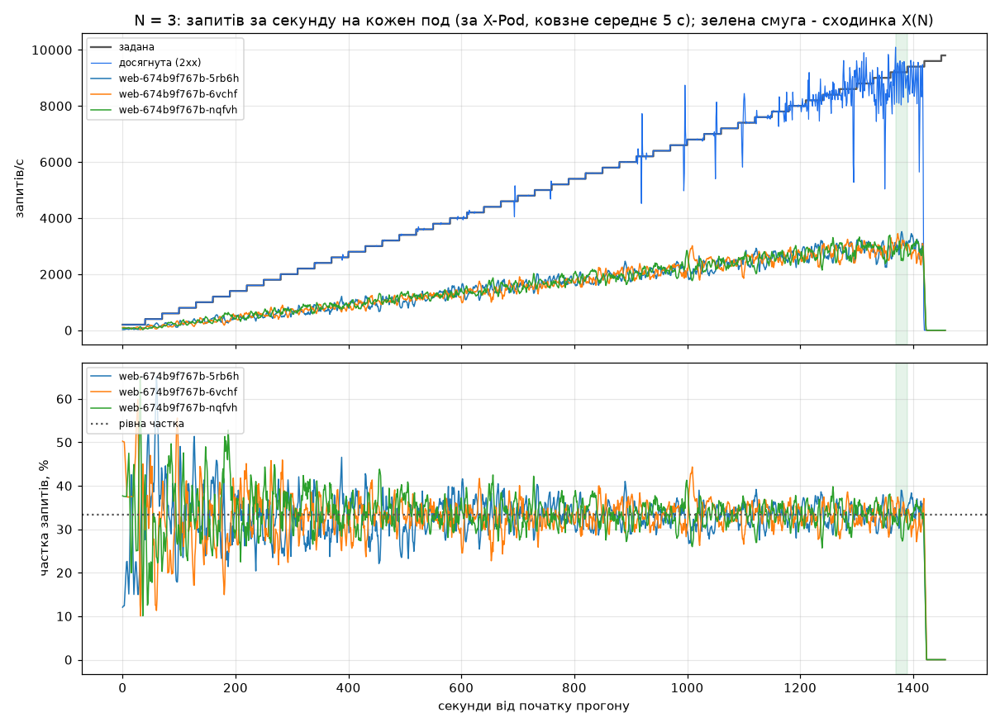
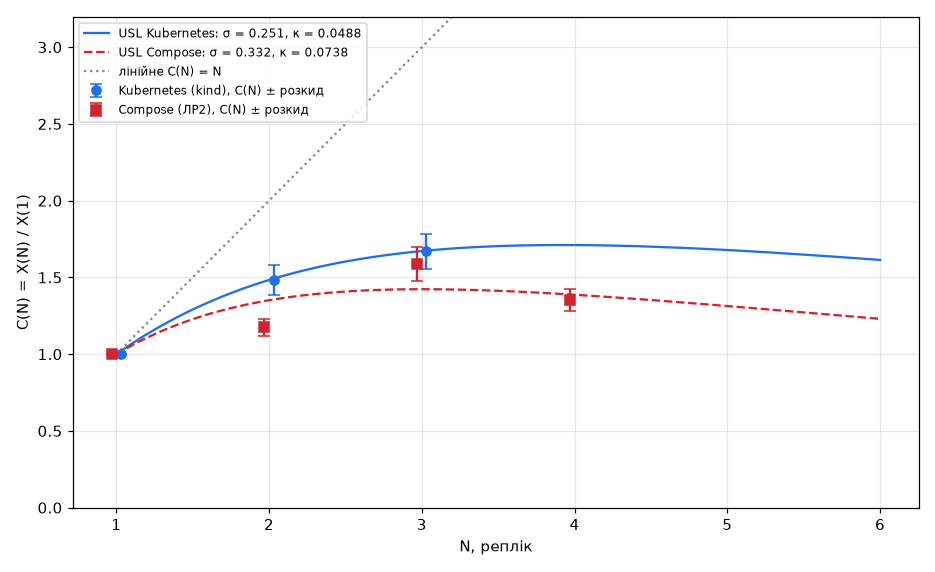
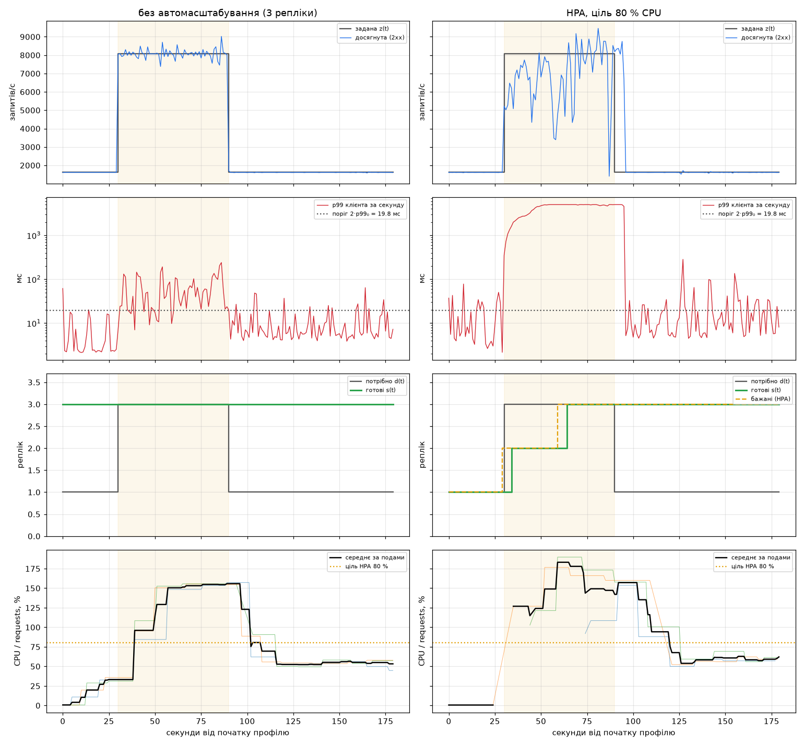
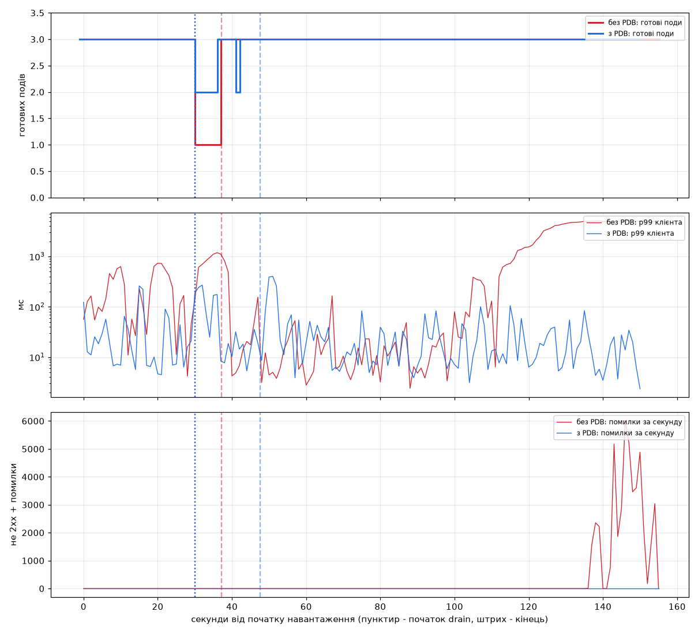

# Лабораторна робота №3. Сервіс у Kubernetes: автомасштабування та стійкість

Варіант 18. 
* Репліки: 3.
* Кластер: kind.
* Ліміти CPU: 500m / 1.
* Ціль HPA: 80% використання CPU.
* Стрибок навантаження: 1.5 * X(1).
* Додаткова вимога: перевірка PodDisruptionBudget (PDB) під час вимкнення робочого вузла (drain).
* Розмір пулу з'єднань з базою: 10.

## Структура проєкту
* `k8s/` – маніфести кластера, бази, вебсервісу, HPA, PDB та моніторингу.
* `scripts/` – скрипти для розгортання (`deploy.sh`), видалення (`destroy.sh`) та запуску тестів.
* `loadgen/` – генератор навантаження та скрипти для збору метрик.
* `checks/` – скрипти перевірки коректності роботи (CRUD, збереження даних, безпека паролів, моніторинг).

## Хід роботи

### Крок 1-2. Кластер і скрипти автоматизації
Зібрав кластер kind. На вузлі control-plane пробросив порти NodePort (30080 та 30090) на localhost:8080 і localhost:9090 для прямого доступу до сервісу та Prometheus. 
Написав скрипти повного циклу. `deploy.sh` створює кластер, збирає образ, завантажує його в kind, створює Secret з пароля з `.env`, розгортає базу, запускає міграцію схеми та встановлює моніторинг. Control-plane отримав мітку `role=infra`, щоб база та моніторинг працювали там, а вебсервіс розміщувався виключно на worker-вузлах.

### Крок 3. База даних
PostgreSQL розгорнуто через StatefulSet з PVC (1 ГБ) та headless Service. Пароль передається через Secret, який створюється з файлу `.env` (сам файл додано до `.gitignore`). 
Перевірка збереження даних пройшла успішно: після створення тестового запису та видалення пода бази, StatefulSet підняв новий под з тим самим диском, і дані були успішно прочитані.

### Крок 4. Вебсервіс
Deployment налаштовано без жорсткого поля `replicas` (кількістю керує HPA або `kubectl scale`). 
Налаштовано проби:
* readiness: перевіряє доступність бази (timeout 3 с).
* liveness: перевіряє живість процесу без звернення до бази (timeout 5 с, failureThreshold 6), щоб уникнути зайвих перезапусків під навантаженням.
Додано preStop паузу на 5 секунд та graceful shutdown uvicorn на 8 секунд для коректного завершення активних запитів. Перевірка підтвердила, що пароль не потрапив у фінальний образ або конфігураційні файли.

### Крок 5. Моніторинг
Prometheus встановлено через Helm. Для економії ресурсів хоста вимкнено Grafana, Alertmanager та збір метрик компонентів, які в kind недоступні. Інтервал збору метрик з podів, cAdvisor, kube-state-metrics та експортера бази становить 5 секунд. Усі цілі в статусі UP.

### Крок 6. Модель навантаження
Генератор працює у відкритому контурі. Використовує пул з 24 постійних keep-alive з'єднань. Кожне з'єднання закривається після 100 запитів і замінюється новим. 
Якщо запит не може отримати вільне з'єднання протягом 5 секунд, він фіксується як таймаут. При цьому саме з'єднання не розривається, а відповідь дочитується у фоні. Це запобігає вичерпанню ефемерних портів на хості, що було проблемою в попередній роботі.

### Крок 7. Прогони без автомасштабування
Тестування на 1, 2 та 3 репліках зі ступінчастим зростанням навантаження:
* 1 репліка: 5384 rps. Под впирається в ліміт 1 CPU (починається тротлінг).
* 2 репліки: 7986 rps.
* 3 репліки: 9001 rps.

На 2 і 3 репліках поди вже не впираються в ліміт CPU. Межа пропускної здатності визначається спільним ресурсом процесора хоста та мережевим шляхом Docker Desktop. При перевищенні цього ліміту черга в генераторі росте, і сервіс повністю перестає відповідати (масові таймаути).

### Крок 8. Дисбаланс навантаження
Коефіцієнт дисбалансу склав 1.02-1.03. Оскільки генератор часто відкриває нові з'єднання, kube-proxy (в режимі iptables) рівномірно розподіляє їх між подами. Навантаження розподіляється майже ідеально.

*Рисунок 1 - Запити за секунду на кожен под і частка кожного пода на 3 репліках; зелена смуга - сходинка X(3)*

### Крок 9. Закон масштабованості
Розрахунок за універсальним законом масштабованості дав оптимальну кількість реплік N* ≈ 3.9. Масштабування вийшло ефективнішим, ніж у Docker Compose, але фізичною межею в обох випадках залишається спільний процесор хоста та мережевий стек віртуальної машини.

*Рисунок 2 - Відносна пропускна здатність C(N) з розкидом і криві закону масштабованості для Docker Compose (ЛР2) і Kubernetes*

### Крок 10. Профіль навантаження
Сценарій: 30 с низьке навантаження (1615 rps), 60 с стрибок (8077 rps), 90 с повернення до низького. 
На фіксованих 3 репліках система тримає стрибок без помилок, хоча p99 зростає до 140 мс. Відтворюваність результатів на межі пропускної здатності низька через фонову активність на хості, яка іноді штовхає систему в перевантаження.

### Крок 11. HPA (автомасштабування)
HPA налаштовано на ціль 80% CPU (мінімум 1, максимум 3 репліки, вікно стабілізації 30 с). 
Під час стрибка HPA додав репліки, але з затримкою близько 34 секунд до повної готовності третього пода. За цей час черга запитів накопичилася, що призвело до 37 тисяч таймаутів. Після завершення стрибка HPA тримав 3 репліки ще майже 2 хвилини, оскільки споживання CPU сервісом сублінійне і не падало нижче порогу для зменшення кількості подів.

### Крок 12. Метрики еластичності
HPA заощадив 18% репліко-секунд порівняно з фіксованими 3 репліками. Ціною цієї економії стали таймаути під час різкого стрибка та тривале утримання зайвих реплік після його завершення.

*Рисунок 3 - Задана і досягнута інтенсивність, p99 клієнта, потрібна d(t) і фактична s(t) кількість реплік, використання CPU відносно requests.cpu: ліворуч без автомасштабування, праворуч з HPA*

### Крок 13. PodDisruptionBudget і drain
Перевірка вимкнення вузла під навантаженням 6000 rps.
* Без PDB: вузол виселяв обидва поди одразу. Навантаження падало на один под, p99 зростав до 1.2 с.
* З PDB (maxUnavailable: 1): виселення йшло по одному. Завжди залишалося мінімум 2 готові поди. p99 не перевищував 0.4 с. Процес drain тривав удвічі довше, але сервіс залишався стабільним і обробляв запити без помилок.

*Рисунок 4 - Готові поди, p99 клієнта і помилки за секунду під час drain; пунктир - початок drain, штрих - кінець*

## Відкинуті рішення
1. **Жорсткий livenessProbe (3 с)**: під навантаженням черга запитів блокувала відповідь, kubelet убивав перевантажений под, що призводило до каскадного збою. Змінено на м'якший варіант (5 с, 6 спроб).
2. **Скидання з'єднання генератором після таймауту**: призводило до вичерпання ефемерних портів і метастабільного збою, коли сервер не встигав нічого обробити. Тепер з'єднання залишається, а відповідь дочитується у фоні.
3. **Жорстке поле `replicas` у Deployment**: конфліктувало з роботою HPA та `kubectl scale`.
4. **Повний стек моніторингу (Grafana, Alertmanager)**: забирав занадто багато ресурсів спільного хоста, що спотворювало результати тестів.

## Висновки
Сервіс успішно перенесено в кластер Kubernetes. База даних зберігає стан між перезапусками, пароль захищений через Secret. Модель з 24 з'єднаннями дозволила досягти 9000 rps на 3 репліках без витрат CPU на постійне створення нових з'єднань. 

HPA економить ресурси, але реагує запізно для різких стрибків навантаження, тому метрика CPU не є ідеальним сигналом для масштабування цього сервісу. PodDisruptionBudget ефективно захищає від деградації продуктивності під час обслуговування вузлів, гарантуючи наявність мінімально необхідної кількості реплік.