# Лабораторна робота №2. Метрики сервісу і межа масштабованості

Варіант 18: розмір пулу зʼєднань 10, набір бакетів гістограми Г3 (1, 2, 4, 8, 16, 32, 64, 128, 256, 512, 1024 мс), додаткова метрика М4 - частка запитів із тривалістю обробки не більшою за поріг, обчислена за лічильником бакета гістограми. Ліміти контейнера web з варіанта лабораторної роботи 1 не змінювались: 1 CPU, 512 МБ.

## Середовище

macOS 26.4.1, Apple M3 Pro (12 ядер: 6 продуктивних і 6 енергоефективних, 36 ГБ памʼяті). Docker 27.4.0 (Docker Desktop): віртуальній машині Docker виділено 12 CPU і 20 ГБ памʼяті (results/docker_resources.txt). Сервіс - Python 3.12, FastAPI 0.143, uvicorn 0.54, asyncpg 0.32, prometheus-client 0.26; PostgreSQL 17, nginx 1.28, Prometheus 3.5.0. Генератор - Python 3.14 на хості. Генератор і стенд працюють на одній машині, тож на верхніх рівнях конкурують за процесор хоста.

## Хід роботи

### Крок 1. Метрики Prometheus (app/metrics.py)

Підключено бібліотеку prometheus_client. Метрики реєструються один раз під час імпорту модуля і оновлюються в проміжному обробнику MetricsMiddleware - це «чистий» ASGI-обробник, без обгортки BaseHTTPMiddleware:

| Метрика | Тип | Мітки | Що рахує |
|---|---|---|---|
| http_requests_total | лічильник | method, path, code | запити |
| http_request_duration_seconds | гістограма, межі Г3 у секундах (0.001 ... 1.024) | method, path | тривалість обробки запиту сервісом |
| http_requests_in_progress | вимірювач | - | запити в обробці зараз |
| process_cpu_seconds_total та інші process_* | лічильник (стандартний колектор) | - | процесорний час процесу |

У мітці path записується шаблон маршруту, який FastAPI кладе в scope після маршрутизації (/vaccine-lots/{lot_id}), а не конкретний ідентифікатор; запити без маршруту отримують path="<unmatched>". Метрики віддаються за GET /metrics. Сервіс запускається одним процесом uvicorn у контейнері (без --workers), тож лічильники одного екземпляра не діляться між процесами.

```python
REQUESTS = Counter("http_requests_total", "HTTP requests handled", ["method", "path", "code"])
DURATION = Histogram("http_request_duration_seconds", "Time spent handling a request", ["method", "path"],
                     buckets=(0.001, 0.002, 0.004, 0.008, 0.016, 0.032, 0.064, 0.128, 0.256, 0.512, 1.024))
IN_PROGRESS = Gauge("http_requests_in_progress", "Requests being handled right now")
```

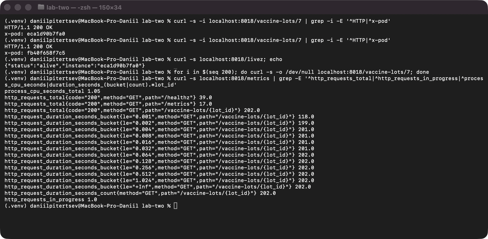

*Рисунок 1 - Заголовок X-Pod з двох різних екземплярів, /livez і метрики одного екземпляра після 200 запитів*

### Крок 2. /livez, X-Pod, DB_POOL_SIZE

- GET /livez повертає 200 і до бази не звертається (на відміну від /healthz, який виконує SELECT 1).
- Імʼя екземпляра береться зі змінної POD_NAME; у стенді її не задано, тому використовується імʼя хоста контейнера. Воно передається в заголовку X-Pod кожної відповіді (додає той самий MetricsMiddleware) - на рис. 1 два запити поспіль отримали відповіді від двох різних екземплярів.
- Розмір пулу читається зі змінної DB_POOL_SIZE (у docker-compose.yml - 10 за варіантом); asyncpg створює пул з min_size = max_size = DB_POOL_SIZE, тож екземпляр ніколи не відкриває більше 10 зʼєднань з базою.

### Крок 3. Коректна зупинка

CMD записано в exec-формі, тож SIGTERM отримує сам процес uvicorn (PID 1). На SIGTERM uvicorn перестає приймати нові зʼєднання, дочікується запитів в обробці (не довше --timeout-graceful-shutdown 8 с), виконує завершення lifespan - закриває пул зʼєднань з базою - і виходить з кодом 0; stop_grace_period у Compose - 15 с, з запасом.

```dockerfile
CMD ["uvicorn", "app.main:app", "--host", "0.0.0.0", "--port", "8000", "--no-access-log", "--timeout-keep-alive", "75", "--timeout-graceful-shutdown", "8", "--loop", "uvloop", "--http", "httptools"]
```

Перевірка - checks/graceful_stop.py: два екземпляри, постійне навантаження 1000 запитів за секунду, через 20 с один контейнер зупиняється командою docker stop:

```text
docker stop vaccine-lots-web-1: exit code 0, took 0.39 s
10 s around the stop (21 s of records): 21001 x 2xx, 0 x non-2xx, 0 connection errors, max p99 19.26 ms
```

Код завершення 0 (docker inspect --format '{{.State.ExitCode}}'), а генератор за 10 с до і після зупинки зафіксував 21001 відповідь 2xx, жодної не 2xx і жодної помилки зʼєднання. Запити, які nginx у цей момент ще слав на зупинений екземпляр, він повторює на іншому (proxy_next_upstream error timeout для GET).

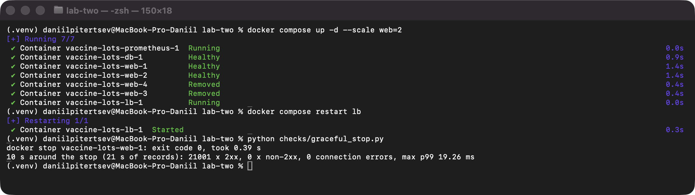

*Рисунок 2 - Зупинка одного з двох екземплярів під навантаженням 1000 rps*

### Крок 4. Prometheus у Docker Compose

Додано сервіс prometheus (prom/prometheus:v3.5.0) з іменованим томом prometheus-data для даних і опублікованим портом 9090. Інтервал збору - 5 с, екземпляри web знаходяться через dns_sd_configs: DNS-запит до вбудованого DNS Docker за іменем сервісу web повертає адреси всіх його контейнерів. Додаткова метрика М4 рахується з уже наявної гістограми, окремий експортер не потрібен.

```yaml
global:
  scrape_interval: 5s
  evaluation_interval: 5s

scrape_configs:
  - job_name: web
    dns_sd_configs:
      - names: ["web"]
        type: A
        port: 8000
        refresh_interval: 5s
```

```yaml
  prometheus:
    image: prom/prometheus:v3.5.0
    command:
      - --config.file=/etc/prometheus/prometheus.yml
      - --storage.tsdb.path=/prometheus
    ports:
      - "${PROMETHEUS_PORT:-9090}:9090"
    volumes:
      - ./.docker/prometheus/prometheus.yml:/etc/prometheus/prometheus.yml:ro
      - prometheus-data:/prometheus
    networks:
      - frontend
```

Кількість екземплярів змінюється командою docker compose up -d --scale web=N, після кожної зміни балансувальник перезапускається (docker compose restart lb). Після запуску з --scale web=4 на сторінці Targets усі чотири екземпляри web мають стан UP (рис. 4).

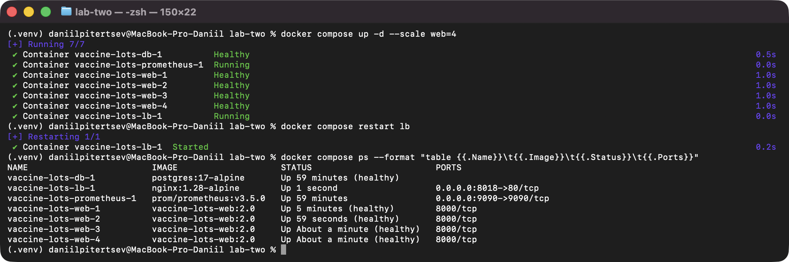

*Рисунок 3 - Запуск чотирьох екземплярів web і перезапуск балансувальника*

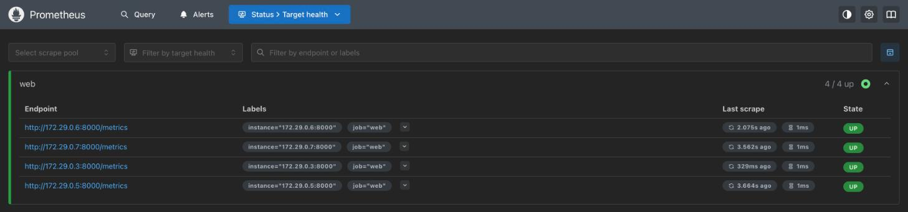

*Рисунок 4 - Сторінка Targets у Prometheus: job web, 4 / 4 up*

### Крок 5. Ступінчастий генератор (loadgen/steps.py)

Генератор - відкритий контур на asyncio: задана інтенсивність ділиться між 12 процесами (за кількістю ядер), кожен процес наперед обчислює моменти відправки і запускає кожен запит окремою задачею, не чекаючи відповіді на попередній. Зʼєднання keep-alive беруться з пулу процесу, нове відкривається, коли вільного немає (разом до 15000 зʼєднань), тож фактична інтенсивність надсилання дорівнює заданій, поки зʼєднання встановлюються (рис. 7-8, жовта лінія). Тайм-аут запиту 5 с; запит, що перевищив тайм-аут, рахується як відповідь не 2xx, а зʼєднання закривається скиданням (SO_LINGER 0), щоб не накопичувати TIME_WAIT. Затримка рахується від запланованого моменту надсилання.

Профіль: прогрів 10 с на рівні 200 запитів за секунду, далі сходинки по 20 с від 200 запитів за секунду з приростом 200. Прогін зупиняється, коли на двох сходинках поспіль досягнута інтенсивність нижча за 0.9 заданої, або після сходинки, що досягла межі генератора G. Сценарій - читання одного запису за ідентифікатором зі ста попередньо занесених (loadgen/seed.py).

Посекундний запис (results/<прогін>/seconds.csv): задана інтенсивність, кількість запланованих і фактично надісланих запитів, досягнута інтенсивність (відповіді 2xx, завершені в цю секунду), кількість відповідей не 2xx (разом із тайм-аутами), помилок зʼєднання, p50, p95 і p99 клієнта. Для кожної сходинки (results/<прогін>/summary.json) середня досягнута інтенсивність і її стандартне відхилення рахуються за останні 15 с, перші 5 с сходинки не враховуються.

Під час кожного прогону loadgen/sampler.py знімає docker stats і процесорний час генератора, а після прогону loadgen/prom_export.py вивантажує з Prometheus потрібні ряди за весь час прогону (results/<прогін>/prometheus.json) - діаграми будуються з цих вивантажень, до видалення томів.

```sh
python loadgen/steps.py --g 8000 --out results/n4
python loadgen/prom_export.py --summary results/n4/summary.json --out results/n4/prometheus.json
```

### Крок 6. Межа генератора G

У nginx додано location = /noop { return 204; }, що відповідає без звернення до web. Прогін проти /noop через той самий опублікований порт 8018 обмежено зверху сходинкою 8000 запитів за секунду (--max-rate 8000), бо без обмеження він тривав би понад пів години: генератор тримав задану інтенсивність на всіх сходинках до 8000 включно, p99 клієнта на останній - 2.5 мс, помилок немає. Тому G ≥ 8000.3 запитів за секунду; у розрахунках використано G = 8000.3, і це консервативна оцінка - справжня межа генератора вища (у пробному прогоні без обмеження генератор тримав понад 14600 запитів за секунду).

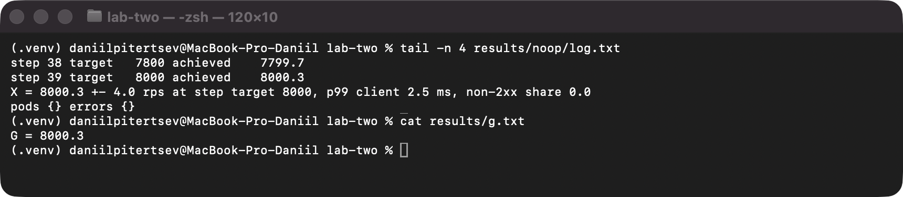

*Рисунок 5 - Останні сходинки прогону проти /noop і G*

### Крок 7. Прогони на 1, 2, 3 і 4 екземплярах

По одному ступінчастому прогону на кожну кількість екземплярів (рис. 6, results/n1 ... results/n4). Ресурси, виділені Docker: віртуальна машина Docker Desktop - 12 CPU, 20 ГБ памʼяті.

| N | X(N), rps | Розкид, rps | Сходинка X(N), rps | p99 клієнта, мс | p99 сервера, мс | Частка не 2xx | CPU одного екземпляра, % | В обробці на екземпляр | Обмежена генератором |
|---|---|---|---|---|---|---|---|---|---|
| 1 | 3400.3 | 147.7 | 3400 | 166.47 | 118.15 | 0 | 61.8 | 10.6 | ні |
| 2 | 4000.0 | 70.4 | 4000 | 90.37 | 76.38 | 0 | 51.5 | 9.2 | ні |
| 3 | 5402.7 | 288.6 | 5400 | 433.55 | 467.11 | 0 | 63.5 | 7.5 | ні |
| 4 | 4599.7 | 120.7 | 4600 | 122.55 | 103.92 | 0 | 47.7 | 13.0 | ні |

CPU - rate(process_cpu_seconds_total[15s]), усереднений за останні 15 с сходинки і по екземплярах (ліміт - 100%); в обробці - avg_over_time(http_requests_in_progress[15s]), так само усереднений; сам запит Prometheus до /metrics теж потрапляє в цей вимірювач, тож у спокої він показує 1. Жодна точка не обмежена генератором: усі X(N) нижчі за 0.9 · G = 7200, і кожен прогін зупинився через дві сходинки поспіль із досягнутою нижчою за 0.9 заданої. Тому ліміт CPU контейнера web не змінювався.

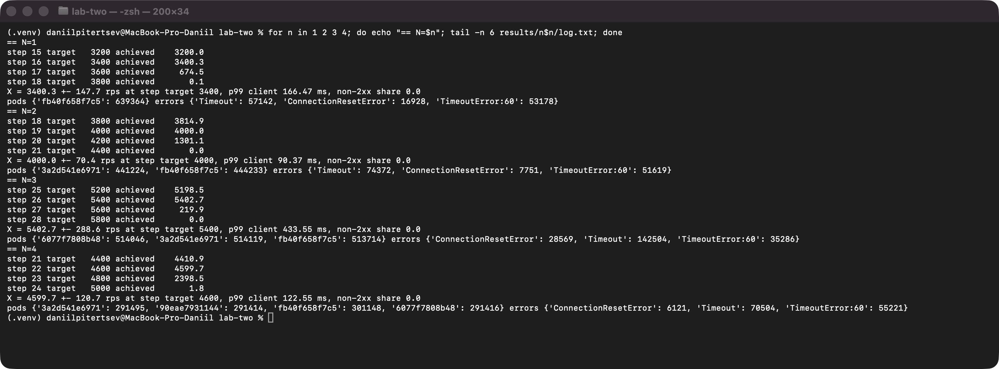

*Рисунок 6 - Останні сходинки прогонів на 1-4 екземплярах, X(N), розподіл відповідей за X-Pod і типи помилок*

Усі прогони закінчились однаково: на сходинці після X(N) досягнута інтенсивність не виходить на плато, а обвалюється майже до нуля. Затримка зростає, генератор відкриває тисячі нових зʼєднань, частина з них не встановлюється (TimeoutError errno 60 - тайм-аут connect), решта чекає 5 с і закінчується тайм-аутом або скиданням (ConnectionResetError), а екземпляри web в цей час майже простоюють (CPU 5-10%) з тисячами запитів в обробці. Помилки на рис. 6 належать саме цим сходинкам перевантаження; на сходинках X(N) частка не 2xx - 0. Для N = 3 p99 сервера (467 мс) вийшов вищим за клієнтський (434 мс) - це межа точності гістограми: значення лежить у бакеті 256-512 мс шириною 256 мс, а вікна Prometheus (крок 5 с) і генератора зсунуті одне відносно одного до 5 с. Через такий обвал оцінка X(N) залежить від того, на якій сходинці стався зрив: у прогоні на двох екземплярах він настав уже на 4200 запитів за секунду (а на сходинці 3400 той самий прогін мав короткочасний сплеск з p99 1.3 с), тому X(2) = 4000 нижче, ніж можна було очікувати між X(1) і X(3).

X(1) = 3400 - більше, ніж 2255 запитів за секунду в лабораторній роботі 1 на тому самому ліміті 1 CPU. Імовірна причина - заміна обробника @app.middleware("http") (BaseHTTPMiddleware) на «чистий» ASGI-обробник і інший генератор з меншим навантаженням на хост; окремо цей внесок не вимірювався.

### Крок 8. Діаграми прогонів на 1 і 4 екземплярах

Для прогонів на 1 і 4 екземплярах побудовано діаграми на спільній осі часу (loadgen/analyze.py): задана, фактично надіслана і досягнута інтенсивність; p99 клієнта (за кожну секунду) і p99 сервера (за вікно 15 с з оновленням кожні 5 с, обчислене за формулою з бакетів); кількість запитів за секунду, використання CPU і кількість запитів в обробці для кожного екземпляра. p99 сервера понад останню скінченну межу показано значенням 1024 мс.

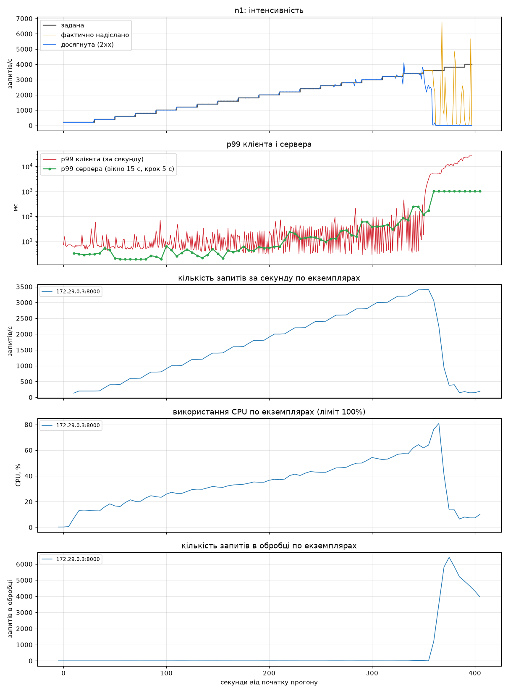

*Рисунок 7 - Прогін на одному екземплярі*

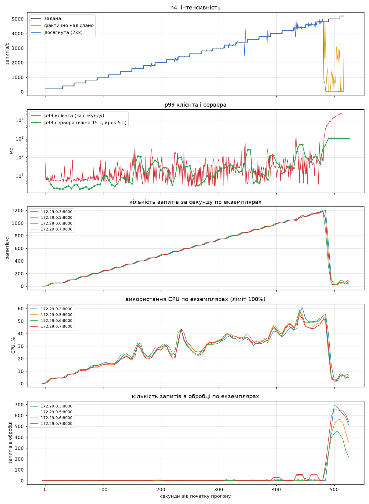

*Рисунок 8 - Прогін на чотирьох екземплярах*

На чотирьох екземплярах запити розподіляються рівно (по 1150 rps на екземпляр на сходинці X(4)), CPU кожного росте разом із навантаженням і на X(4) становить лише 45-60%; до зриву кількість запитів в обробці на екземпляр близька до нуля, після зриву - сотні.

Ті самі ряди безпосередньо в інтерфейсі Prometheus (вкладка Graph, той самий часовий проміжок прогону, дані з тому prometheus-data). p99 сервера тут рахує вбудована histogram_quantile - за тією самою лінійною інтерполяцією всередині бакета, тому значення збігаються з рис. 7-8, а понад останню межу вона так само повертає 1.024 с.

| Ряд | Запит PromQL |
|---|---|
| запитів за секунду по екземплярах | sum by (instance) (rate(http_requests_total{path="/vaccine-lots/{lot_id}"}[15s])) |
| CPU по екземплярах (частка ядра) | rate(process_cpu_seconds_total{job="web"}[15s]) |
| p99 сервера | histogram_quantile(0.99, sum by (le) (rate(http_request_duration_seconds_bucket{path="/vaccine-lots/{lot_id}"}[15s]))) |
| М4: частка запитів ≤ 4 мс | sum(rate(http_request_duration_seconds_bucket{path="/vaccine-lots/{lot_id}",le="0.004"}[15s])) / sum(rate(http_request_duration_seconds_count{path="/vaccine-lots/{lot_id}"}[15s])) |

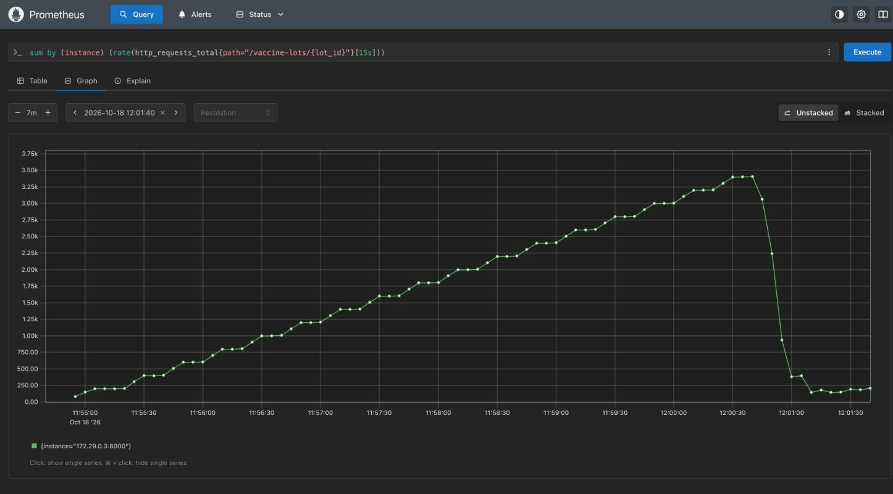

*Рисунок 9 - Prometheus, прогін на одному екземплярі: запитів за секунду*

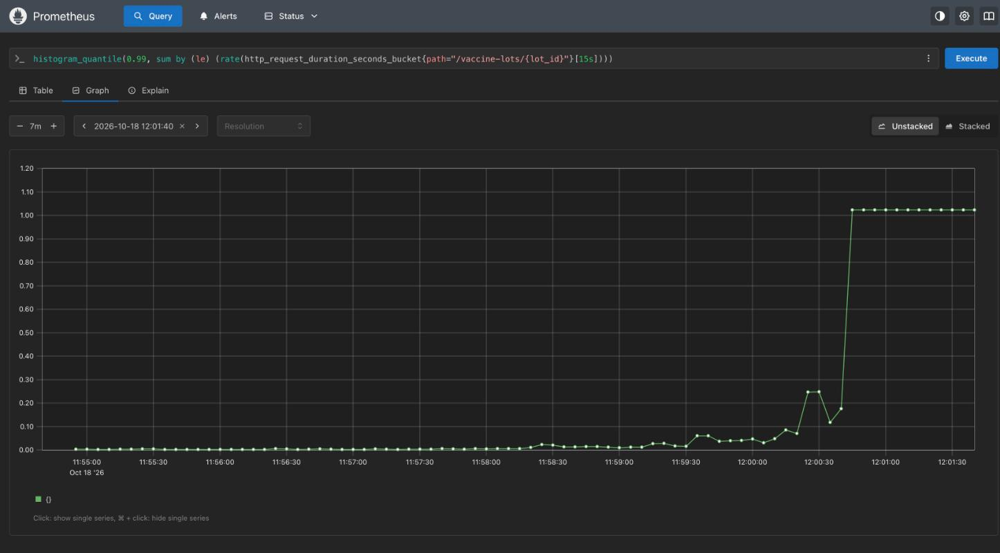

*Рисунок 10 - Prometheus, прогін на одному екземплярі: p99 сервера, с*

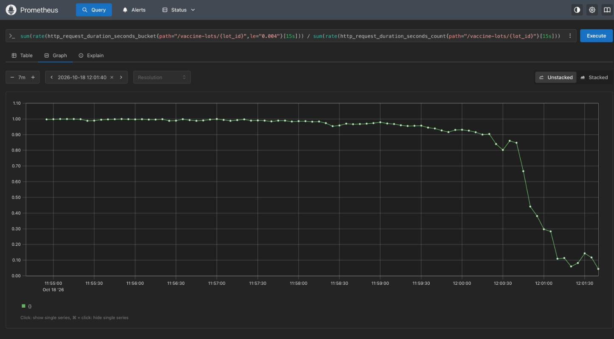

*Рисунок 11 - Prometheus, прогін на одному екземплярі: частка запитів, оброблених не довше 4 мс*

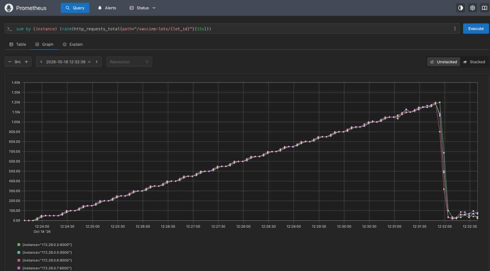

*Рисунок 12 - Prometheus, прогін на чотирьох екземплярах: запитів за секунду по екземплярах*

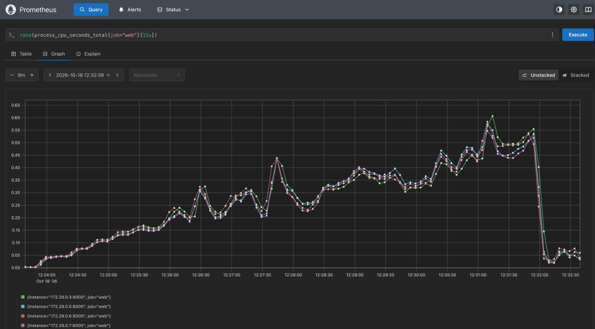

*Рисунок 13 - Prometheus, прогін на чотирьох екземплярах: використання CPU по екземплярах*

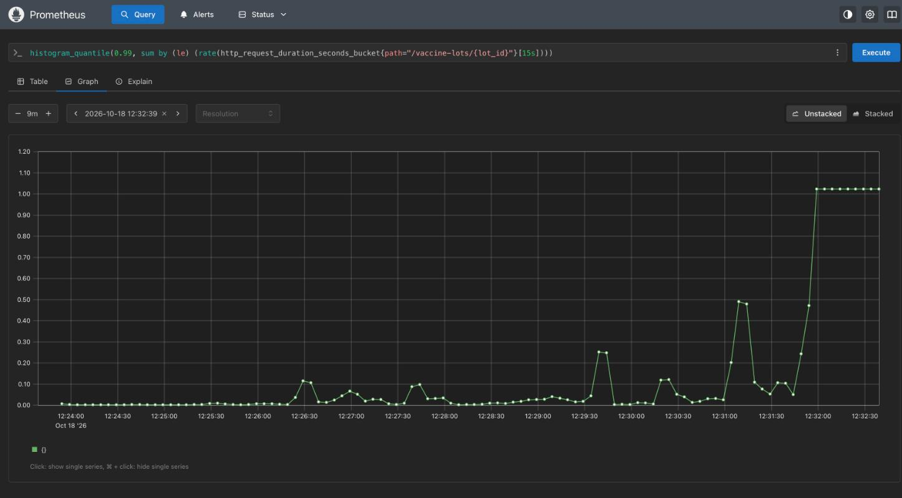

*Рисунок 14 - Prometheus, прогін на чотирьох екземплярах: p99 сервера, с*

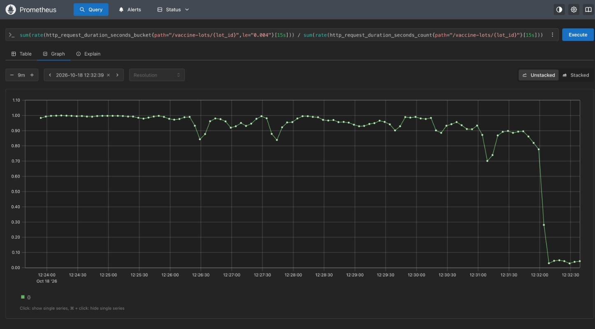

*Рисунок 15 - Prometheus, прогін на чотирьох екземплярах: частка запитів, оброблених не довше 4 мс*

### Крок 9. p99 клієнта і p99 сервера на одному екземплярі

p99 сервера рахується за приростами лічильників бакетів за останні 15 с сходинки: ранг r = 0.99 · n, бакет i, для якого c(i-1) < r ≤ c(i), Q = b(i-1) + (b(i) - b(i-1)) · (r - c(i-1)) / (c(i) - c(i-1)); максимальна похибка - ширина бакета b(i) - b(i-1).

| Сходинка, rps | p99 клієнта, мс | p99 сервера, мс | Бакет, мс | Макс. похибка, мс |
|---|---|---|---|---|
| 200 | 7.93 | 3.12 | 2-4 | 2 |
| 400 | 6.90 | 2.08 | 2-4 | 2 |
| 600 | 6.08 | 1.92 | 1-2 | 1 |
| 800 | 7.77 | 2.49 | 2-4 | 2 |
| 1000 | 7.41 | 2.54 | 2-4 | 2 |
| 1200 | 8.53 | 2.69 | 2-4 | 2 |
| 1400 | 11.61 | 3.25 | 2-4 | 2 |
| 1600 | 16.88 | 4.27 | 4-8 | 4 |
| 1800 | 13.66 | 6.04 | 4-8 | 4 |
| 2000 | 23.27 | 6.12 | 4-8 | 4 |
| 2200 | 28.98 | 13.20 | 8-16 | 8 |
| 2400 | 23.67 | 11.91 | 8-16 | 8 |
| 2600 | 43.47 | 26.94 | 16-32 | 16 |
| 2800 | 64.39 | 60.34 | 32-64 | 32 |
| 3000 | 59.41 | 40.90 | 32-64 | 32 |
| 3200 | 86.74 | 85.21 | 64-128 | 64 |
| 3400 | 166.47 | 118.15 | 64-128 | 64 |
| 3600 | 7799.73 | > 1024 | > 1024 | не обмежена |
| 3800 | 21903.33 | > 1024 | > 1024 | не обмежена |

p99 клієнта завжди більший за p99 сервера: клієнт бачить ще й мережу Docker Desktop, чергу nginx, чергу перед обробником усередині uvicorn і власну затримку генератора, а сервер - лише час від входу в обробник до відповіді. На малих інтенсивностях різниця - кілька мілісекунд (близько 5 мс), на 2800-3200 запитів за секунду p99 сервера майже наздоганяє p99 клієнта - затримку визначає вже сам сервіс. Набір Г3 подвоює межі, тож відносна похибка оцінки постійна (до двох разів), а абсолютна росте разом із затримкою - від 1-2 мс на малих інтенсивностях до 64 мс на сходинках 3200-3400. Після зриву p99 сервера лежить за останньою межею 1024 мс, і гістограма показує лише «> 1024 мс», тоді як клієнт бачить секунди.

### Крок 10. Універсальний закон масштабованості

λ = X(1) = 3400.3 запитів за секунду. C(N) = X(N) / X(1); y(N) = N / C(N) - 1, u(N) = N - 1, v(N) = N(N - 1). У підбір входять усі N > 1 (жодна точка не обмежена генератором).

| N | X(N) | C(N) | y(N) | u(N) | v(N) |
|---|---|---|---|---|---|
| 1 | 3400.3 | 1.000 | 0 | 0 | 0 |
| 2 | 4000.0 | 1.176 | 0.7002 | 1 | 2 |
| 3 | 5402.7 | 1.589 | 0.8881 | 2 | 6 |
| 4 | 4599.7 | 1.353 | 1.9570 | 3 | 12 |

Σu² = 14, Σv² = 184, Σuv = 50, Σuy = 8.3473, Σvy = 30.2127; знаменник Σu² · Σv² - (Σuv)² = 14 · 184 - 50² = 76.

σ = (Σv² · Σuy - Σuv · Σvy) / 76 = (184 · 8.3473 - 50 · 30.2127) / 76 = (1535.90 - 1510.63) / 76 = 0.3325

κ = (Σu² · Σvy - Σuv · Σuy) / 76 = (14 · 30.2127 - 50 · 8.3473) / 76 = (422.98 - 417.36) / 76 = 0.0739

Обидві оцінки додатні, однопараметрична формула не знадобилась. За κ > 0 і σ < 1 максимум досягається при

N* = √((1 - σ) / κ) = √((1 - 0.3325) / 0.0739) = √9.04 = 3.01

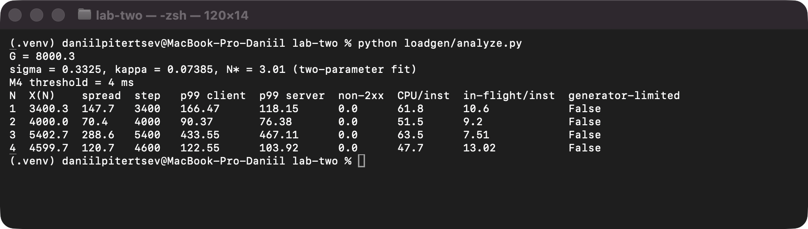

*Рисунок 16 - Вивід loadgen/analyze.py: G, σ, κ, N*, поріг М4 і рядки таблиці кроку 7*

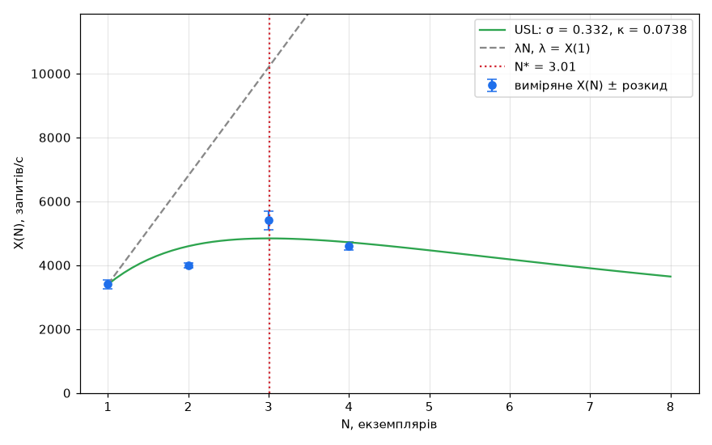

*Рисунок 17 - Виміряні X(N) з розкидом, крива закону з σ = 0.333, κ = 0.0739 і пряма λN*

σ = 0.33 означає, що близько третини роботи на запит виконується послідовно на спільному ресурсі, і без κ пропускна здатність прямувала б до λ / σ ≈ 10200 запитів за секунду. κ = 0.074 у цьому стенді не означає узгодження стану між екземплярами - вони не обмінюються даними між собою; додатне κ тут дає те, що X(4) виявився нижчим за X(3). Модель за чотирма одиночними прогонами чутлива до випадкового зриву на окремій сходинці (див. крок 7), тому N* ≈ 3 треба читати як «на цьому стенді понад три екземпляри вже не дають приросту», а не як точне значення.

### Крок 11. Спільний ресурс

На сходинці X(4) (4600 запитів за секунду) docker stats і процесорний час генератора (results/n4/stats.jsonl, середнє за 15 с сходинки):

| Контейнер / процес | CPU, % | Памʼять |
|---|---|---|
| web-1 / web-2 / web-3 / web-4 | 63.4 / 57.3 / 58.8 / 56.5 | 170 / 101 / 81 / 58 МіБ |
| db | 56.1 | 95 МіБ |
| lb (nginx) | 50.7 | 36 МіБ |
| prometheus | 0.1 | 28 МіБ |
| генератор (12 процесів) | 83.6 | 147 МБ |

Окремим 30-секундним прогоном на тому самому рівні 4600 запитів за секунду (loadgen/host_sampler.py, results/host_probe) знято процесор хоста: зайнято 72.5% з 12 ядер; процес віртуальної машини Docker - 550% (5.5 ядра), com.docker.backend (проброс портів Docker Desktop) - 62%, генератор - 72%. Окремо на одному екземплярі виміряно дроселювання за cgroup cpu.stat (results/throttling/cpu_stat.txt): на 3000 запитів за секунду екземпляр у середньому використовує лише 0.6 ядра, але в 11.8% періодів по 100 мс упирається в квоту 1 CPU (1.46 с дроселювання за 22 с).

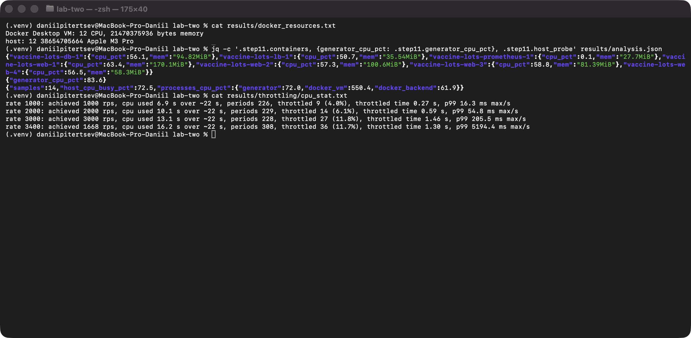

*Рисунок 18 - Ресурси Docker, docker stats на сходинці X(4), процесор хоста і дроселювання CPU*

Додаткова метрика М4. Поріг - межа бакета, найближча до p99 сервера на першій сходинці прогону на одному екземплярі: p99 = 3.12 мс, найближча межа 4 мс (до 2 мс - 1.12, до 4 мс - 0.88). Частка запитів, оброблених не довше 4 мс, = приріст http_request_duration_seconds_bucket{le="0.004"} / приріст лічильника le="+Inf" за останні 15 с сходинки, сума по екземплярах:

| Задана, rps | 200 | 1000 | 2000 | 3000 | 3200 | 3400 | 3600 | 4000 | 4400 | 4600 | 4800 | 5000 |
|---|---|---|---|---|---|---|---|---|---|---|---|---|
| N = 1, % | 100.0 | 99.8 | 98.4 | 93.0 | 90.1 | 86.1 | 38.2 | - | - | - | - | - |
| N = 4, % | 99.9 | 98.6 | 94.7 | 94.0 | 95.0 | 90.2 | 99.0 | 95.7 | 86.9 | 89.4 | 77.8 | 4.9 |

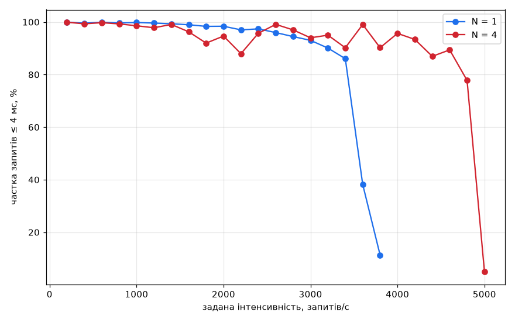

*Рисунок 19 - Частка запитів, оброблених не довше 4 мс, залежно від заданої інтенсивності*

На одному екземплярі частка швидких запитів плавно падає з 100% до 86% до сходинки X(1) і обвалюється після неї; на чотирьох вона довше тримається біля 90-99%, але вже з 1800 запитів за секунду коливається сильніше, ніж на одному, хоча на кожен екземпляр припадає вчетверо менше запитів.

Висновок про спільний ресурс. Жоден контейнер на X(4) не впирається у свій ліміт: web - 47-63% з 100%, база - 56%, nginx - 51%. Пул зʼєднань з базою (10 на екземпляр) теж не межа: на X(4) в обробці в середньому 13 запитів на екземпляр, і база загалом зайнята лише на 56%. Спільним для всіх екземплярів і найбільш навантаженим ресурсом є процесор хоста: віртуальна машина Docker займає 5.5 ядра, хоча самі контейнери разом використовують близько 3.5 (решта - мережа і ядро віртуальної машини), генератор - ще близько 0.8, проброс портів Docker Desktop - 0.6, і хост зайнятий на 72.5% з 12 ядер, з яких лише 6 продуктивні. У такій тісноті екземпляри web отримують процесорний час поштовхами: середнє використання далеке від 100%, але квота cgroup регулярно вичерпується (дроселювання в 12% періодів), затримка обробки росте (М4 падає), генератор відкриває нові зʼєднання, і шлях хост - Docker Desktop - nginx перестає їх встигати встановлювати, що й дає зрив на сходинці після X(N). Тобто зростання X(N) обмежує спільний процесор хоста разом із мережевим шляхом Docker Desktop, а не база і не балансувальник. Це висновок за непрямими даними: ізольованого прогону з генератором на окремій машині не було.

## Відкинуті рішення

1. Гістограма через BaseHTTPMiddleware (@app.middleware("http")). Відкинуто: такий обробник для кожного запиту створює додаткову задачу і передає відповідь через внутрішній потік anyio, що помітно дорожче на гарячому шляху; «чистий» ASGI-обробник додає X-Pod і метрики без цього.
2. Генератор на пулі потоків з лабораторної роботи 1. Відкинуто: щоб фактична інтенсивність надсилання дорівнювала заданій при тайм-ауті 5 с, потрібні тисячі одночасних запитів, а потоки на це погано масштабуються; asyncio тримає тисячі зʼєднань у кожному з 12 процесів.
3. histogram_quantile у Prometheus для p99 сервера. Відкинуто для розрахунків: завдання задає власну формулу оцінки і її похибку, тому p99 обчислюється в loadgen/analyze.py з приростів бакетів за формулою; інтерполяція та сама.
4. Окремий експортер для М4. Відкинуто: частка запитів не довше порога рахується з лічильника бакета вже наявної гістограми, окремий процес нічого не додав би.
5. Прогін проти /noop без верхньої межі. Відкинуто з міркувань часу: генератор тримав понад 14600 запитів за секунду, і прогін тривав би понад пів години, а для висновку «точка не обмежена генератором» достатньо G ≥ 8000, бо всі X(N) нижчі за 7200.

## Висновки

Сервіс доповнено метриками Prometheus (лічильник запитів, гістограма тривалості з бакетами Г3, вимірювач запитів в обробці, процесорний час), ендпоінтом /livez, заголовком X-Pod і пулом у 10 зʼєднань з DB_POOL_SIZE. Сервіс коректно зупиняється за SIGTERM: код завершення 0, під навантаженням 1000 запитів за секунду - жодної помилки за 10 с навколо зупинки. Prometheus знаходить усі екземпляри через dns_sd_configs, з --scale web=4 усі чотири мають стан UP.

Межа генератора G ≥ 8000 запитів за секунду, жодна точка серії нею не обмежена. Пропускна здатність: X(1) = 3400, X(2) = 4000, X(3) = 5400, X(4) = 4600 запитів за секунду; за універсальним законом σ = 0.33, κ = 0.074, N* ≈ 3. p99 клієнта завжди більший за p99 сервера на час мережі і черг, на останніх сходинках перед зривом p99 сервера наближається до клієнтського, а після зриву виходить за останню межу 1024 мс. Зростання X(N) обмежує не база і не балансувальник, а спільний процесор хоста разом із мережевим шляхом Docker Desktop: на X(4) хост зайнятий на 72.5%, віртуальна машина Docker - на 5.5 ядра, а екземпляри web при середньому завантаженні 50-60% регулярно дроселюються за квотою CPU. За межею кожен прогін не виходить на плато, а обвалюється, тому оцінки X(N) з одиночних прогонів мають помітний розкид.
